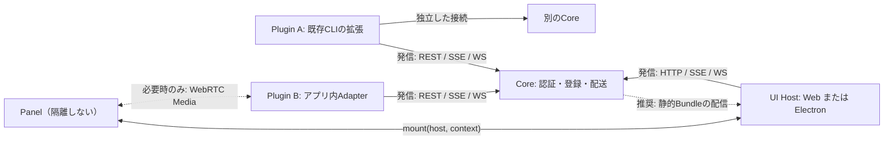
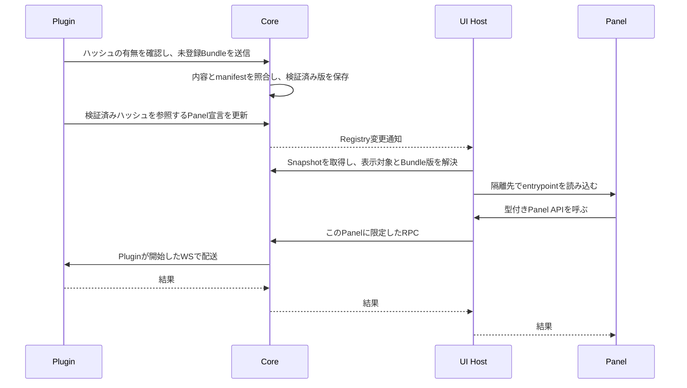
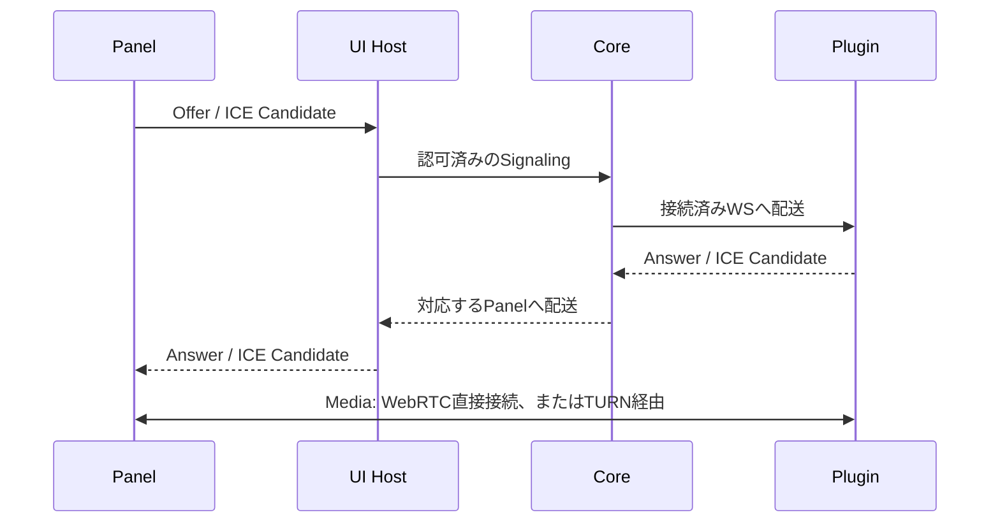

## 合意済みの方針と責務

旧[システム構成 00001](00001-system-structure.md)を置き換える。合意の範囲は[Decision 00012](../decisions/00012-plugin-initiated-connections.md)を正本とする。以降の構成図と通信例は実装済みの姿ではなく、PoCで比較する推奨案。

| 構成要素 | 責務 | 担わないこと |
|---|---|---|
| Core（Go） | 共通HTTP入口、登録と宣言の管理、認証・認可、通知、RPC配送。推奨案では静的Bundleの保管・配信も担う | AI推論、Toolの選択、アプリ固有の認証情報管理、Panelの実行、標準経路でのメディア転送 |
| Plugin | 既存CLI・アプリ内Adapterまたは専用プロセスとして動く。Coreごとに接続と宣言を管理し、Tool・Panel API・UI Bundleを提供できる | PlugumiのためのHTTP/WS待受、独自ドメインの公開 |
| UI Host | Web PluginまたはElectron Pluginが提供する役割。Panelを表示し、PanelにToolの呼び出しなどの手段を渡す。UI HostなしでもCoreとPluginは動く | CoreやPluginプロセスの寿命管理。閉じたPanelの通話や購読を維持する義務 |
| Node | Pluginの実行環境を表す。ホスト、コンテナや別マシンを含む | 認証主体や暗黙のTool配送先としての使用 |

矢印は接続の開始方向を示す。WS確立後は双方向に呼び出せる。Toolの共通経路は `呼び出し元 → Core → 対象Plugin` で、別Pluginへの直接接続を必要としない。メディア経路は別に扱う。同じPluginプロセスでも、CoreごとにURL・資格情報・登録・Snapshot・RPC相関を分離する。アプリ内で状態を共有するかはPluginが決める。

## Webの表示入口

WebとElectronは独立したPluginとする。Webがどう配信されるかをElectronに強制しない。Electron PluginはWeb Pluginの配る画面をwindowで開くだけのviewerとし、CoreへはWeb Pluginが接続する（[Decision 00015](../decisions/00015-electron-plugin-shares-plugin-shell.md)）。Coreが静的ファイルを配信する場合も、Panelの配置・実行・BridgeはUI Hostの責務とする。

| 比較軸 | A: Coreが配信 | B: Web PluginがGatewayを提供 | C: 単一CoreはA、統合時のみGateway |
|---|---|---|---|
| 複数Core | タブ別は可能。単一画面からの同時操作にはCoreごとの到達性とブラウザ接続契約が要る | Gatewayが複数Coreを集約。各操作者の権限を接続先へ伝える必要がある | 単一Coreの導入を軽くし、同時操作が必要な組織だけGatewayを追加 |
| 責務・配布 | Web PluginはUIを提供し、Coreが静的配信。Pluginサーバー不要 | Web Pluginだけはブラウザ向けサーバーを運用。Core本体はUIの入口を持たなくてもよい | 二つの運用形態と、その適合確認が必要 |
| Origin・認証 | UI Hostの制御面は同一Originにできる。別CoreのCookie/CORS/WS Originは別途設計 | 表示入口は同一Originにできるが、Core別の認証状態・Cookie・権限伝播はGatewayの責務 | 単一Coreで認証を簡単に保ちつつ、統合時は別の信頼境界を追加 |
| SSE・WS | 追加Proxyは不要。トンネルを使う場合は別途検証 | SSEのflush、途中のidle timeout、WS upgradeが必要 | Gateway経由だけでなく直接接続も検証対象 |
| iframe・組織内公開 | Panelは信頼されたHostのOriginから分離。公開範囲はCoreごとに設定 | Gatewayを入口に集約可能。Core間・Panel間で認証やOriginを共有しない | どちらでも同じ隔離・認可基準を満たせることが条件 |

**採用:** [Decision 00013](../decisions/00013-web-plugin-gateway.md)でBを採用した。以下の推奨案は採用前の比較として残す。

**推奨案（置き換え済み）:** PoCはAで単一Coreの表示経路を検証する。Cは「単一画面で複数Coreを同時操作する」需要が確認できたときの候補。B/Cの採用やリバースプロキシの必須化はしない。

**失敗条件:** Aで任意PanelコードがCoreの管理Originと権限を共有してしまう場合は公開しない。B/CでGatewayの広い権限が操作者個別の認可を迂回する、Core Aの資格情報がBへ流れる、SSEがバッファされる、WS upgradeが通らない場合は統合入口として採用しない。

## UI BundleとPanel通信

**採用:** UIファイルの受け渡しは[Contract 00004](../contracts/00004-plugin-client-protocol.md)の「UIファイルとPanelの宣言」、Panelのモジュールは[Contract 00005](../contracts/00005-panel-module.md)で定めた。[Decision 00014](../decisions/00014-panel-runs-unisolated.md)により、Panelは隔離せずにWeb Pluginの画面で動かす。以下の隔離とBridgeを前提にした推奨案・図・未決事項・仮説は、採用前の比較として残す。

**推奨案（置き換え済み）:** Pluginはmanifestと相対パス付きのビルド成果物をBundleとして渡す。ハッシュを版の識別に使い、不足するBundleだけを送る。検証が完了したBundleのみPanelの宣言から参照できるようにする。JSの動的import、CSS、画像、フォント、chunkを含めて元のディレクトリ構造で配信する。

**未決事項:** アーカイブ形式、manifest、キャッシュ・差分更新・退役、Originの分け方、CSP、iframe sandbox、Bridgeの具体API。PoCでも、管理Originで任意のBundleを実行する案や、Core資格情報をPanelへ渡す案は取らない。Bundle受付は展開先の逸脱、symlink、重複パス、サイズ超過、MIME不一致を検査し、認可されない版を配信しない。開発用Vite/HMRは本番配信とは別に扱う。

**検証が必要な仮説:** 別Originのiframeと限定Bridgeで動的import等を保ちつつ、親のDOM・資格情報・他Panelへアクセスさせずに操作できる。隔離のためにAsset取得が失敗する場合は、任意Originを許可するのではなく、配信と認証の設計を再検討する。

## WebRTCの経路

**合意済みの方針:** Core経由の制御通信とMediaを分ける。WebRTC PeerになるためにPluginのHTTP/WS待受は不要。CoreへのHTTPS/WSがTunnelを通っても、Mediaが通る証拠にはならない。

**推奨案・未決事項:** まず直接接続を検証し、NAT・Firewallで失敗する環境ではTURNを比較する。多数のPanelへ同じ映像を送る場合は、Core内Relayの実装・運用が小さく済むか、独立Relay/SFUで障害・帯域を分離すべきかを測る。旧SlopDockの同一ホストPoCがあっても、組織間や本番NAT越えの証拠にはしない。

## Coreの到達性と公開範囲

bind先はサーバーが待受するinterface、Core URLは相手が実際に到達できるURL。同じ文字列である必要はない。たとえば `0.0.0.0` はbind先であり、Pluginへ案内するURLではない。

| 環境・候補 | 利点・推奨する検証順 | 失敗条件・注意 |
|---|---|---|
| 同一OS / LAN | まずloopback。LANは許可したinterface・FirewallとTLSで検証 | loopbackは別ホストから届かない。LANにbindしただけでは認証されない |
| Docker / WSL | コンテナ・ゲストからホストへの経路を利用。Docker Desktopのホスト名やWSLのネットワークモード別に確認 | ゲスト内 `localhost` は通常ゲスト自身を指す。ホスト経路、bind、Firewallを実測する |
| Tailscale / VPN | 管理下デバイスの第一候補。VPN内に到達性を限定し、Core側でも操作権限を判定 | 名簿・ACL・組織のデバイス条件が必要。VPN参加は全権を意味しない |
| Cloudflare Tunnel + Access / ngrok等 | VPNを入れられない組織端末の候補。HTTPS入口とIdP、CLIのサービス認証、HTTP/SSE/WS通過を確認 | 公開入口の認証による制限はVPN内にだけ到達可能な構成とは異なる。Coreは認証済み入口を迂回できない構成とし、Media到達は別に測る |

**推奨案:** まず公式CLI・sidecar等をCoreの外で扱う。Core直接組込みは接続設定のUXを改善し得るが、Providerの依存・更新・秘密管理をCoreに持ち込む。外部構成では利用者がヘルスチェックや再起動を管理する必要がある。選定はトレードオフと実測に基づく。

**未決事項:** 組織のIdP、ブラウザとPluginの認証・失効、監査、Providerとの統合範囲。登録、管理、RPC、Panel、Bundle配信を一つの権限にしない。認証・認可・失効が未実装の旧試作をそのまま外部公開しない。

接続とRPCの草案は[Contract 00004](../contracts/00004-plugin-client-protocol.md)、実装との差分と移行順は[Design 00003](../designs/00003-plugin-client-migration.md)を参照。
