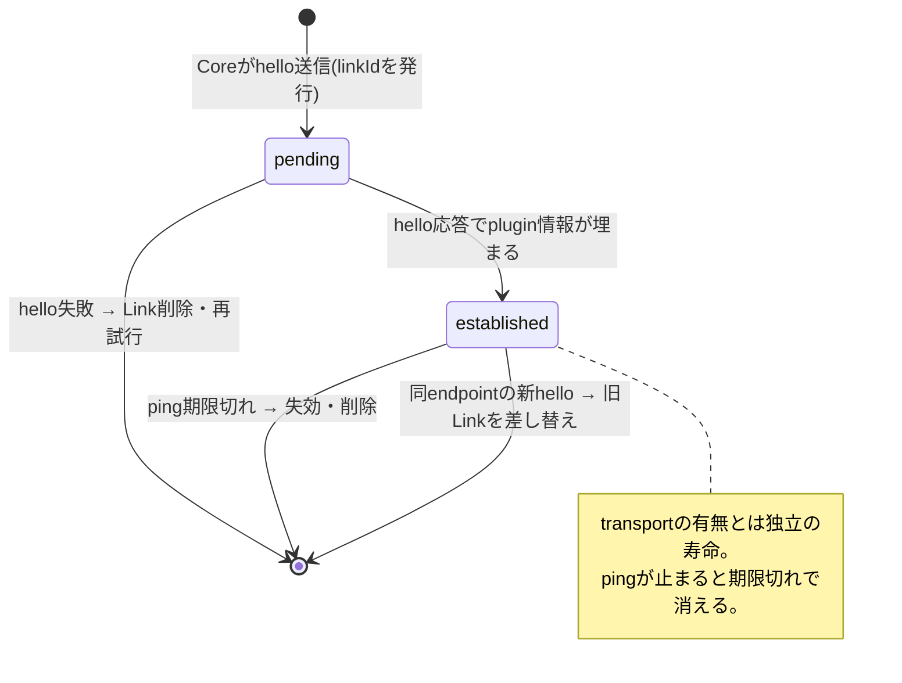
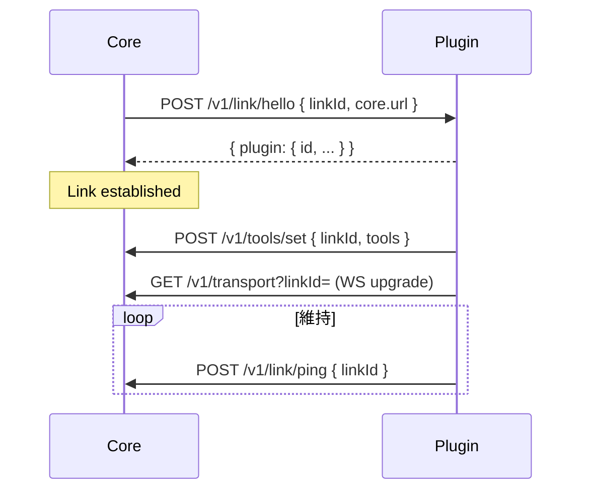

## 当事者と範囲

Core と Plugin の双方が実装する通信境界。本contractは **HTTP/1.1 + JSON のREST面**を規定する。Tool呼出・途中出力・通知などrequest/responseで表せない部分は **transport（`docs/contracts/00002`）**、呼出形態は `docs/contracts/00003`。

- Pluginプロセスは外部起動を前提とする（Coreはspawnしない）
- Panel ↔ Plugin の通信は本契約の対象外。Pluginのフロントエンド⇄バックエンド間はWS・WebRTC・GraphQL等を自由に選んでよい。Plugumiが規定するのはCore↔Pluginと、UIを提供・配置する枠組みだけ
- 接続開始は必ず **Core → Plugin**（`docs/decisions/00004`）。Pluginは接続前にCoreの情報を一切知らない

## Endpoint

- Pluginは `http://<host>:<port>` で待受し、CoreからのREST呼出を受ける
- Coreは `http://<host>:<port>` で待受し、PluginからのREST呼出を受ける。CoreのURLは `link.hello` でPluginに伝える
- MVPはloopback・認証トークン無し。リモート接続・TLS・認証は `docs/decisions/00003` に従い後付け可能な別設計事項

## 共通規則

- request/responseのbodyはJSON（`Content-Type: application/json`）
- 本書のJSON例は説明用であり、フィールドの順序・余分な空白に意味はない
- 未知のフィールドを受け取った側は無視してよい（forward compatibility）

### バージョン

- **URL prefix `/vN/` がプロトコル版である**（`v1`・`v2`…の整数版）。全operationはこのprefixの下に置く
- version情報はbodyに持たない — pathだけがversion情報源
- **互換性ルール**: 同じ `/vN/` 同士は互換。破壊的変更はversionを進めて `/v2/` 等を新設する
- サポート外の `/vN/`（Nは数字）へのリクエストは `426 protocol_mismatch` で応答する。**受け手側の責務** — Pluginは `/v1/` 以外の `/vN/` を知らない場合426を返し、Coreも同様にPluginからの未サポートversion呼出を426で拒否する
- `/vN/` 以外の未知pathは `404 unknown_endpoint`

### エラー応答

エラーはHTTPステータスと、次の形のbodyで返す。

```jsonc
{ "error": { "code": "<error-code>", "message": "<人間向け説明文>" } }
```

| HTTP | code | 発生条件 |
|---|---|---|
| 400 | `invalid_params` | 必須フィールドの欠落・型の不一致 |
| 400 | `invalid_endpoint` | `POST /v1/plugins` のendpointがhttp(s) URLでない |
| 401 | `unknown_link` | `linkId` が未知・失効済み（hello前・ping期限切れ） |
| 404 | `unknown_endpoint` | 存在しないoperationへのPOST |
| 409 | `duplicate_endpoint` | `POST /v1/plugins` で既知のendpointを再登録 |
| 409 | `duplicate_tool_path` | `tools.set` 内の `toolPath` が重複 |
| 426 | `protocol_mismatch` | サポート外の `/vN/` prefix へのリクエスト |

`message` は人間向けで自由。実装は `code` とHTTPステータスのみで判定すること。

## 用語

Link・linkId・Transport・core_url 等の定義は `docs/glossary.md` を正本とする。

- **Link**: CoreとPluginが確立する1つの接続・登録単位。`linkId` がLink識別とTool呼出の宛先を兼ねる
- **Transport**: Link配下の双方向通信路（`docs/contracts/00002`）。REST面のライフサイクルとは別

## Plugin Endpointの解決

Coreは起動設定（`plugumi.json` の `plugins[]`）でPlugin Endpoint一覧を持ち、各Endpointへ接続を試みる。実行中に `POST /v1/plugins` で追加登録もできる。

- 接続不能なEndpointへのhelloは再試行を続ける（間隔は実装詳細・推奨値は後述）
- 動的登録はランタイムのみ有効で、再起動で消える

## Linkのライフサイクル





1. CoreはPluginのHTTP Endpointへ `POST /v1/link/hello` を送る。Coreが払い出した `linkId`・`core.url` を伝え、Pluginは自身の識別情報を返す
2. Pluginは以後 `core.url` 宛てに `tools.set`・`link.ping`・transport接続を行う
3. Linkは `link.ping` の定期送信で維持する。Coreは最終pingから失効期限を超えたLinkを削除する
4. Link失効でTool宣言・紐付くcallはすべて消える（link-scoped）
5. 同じendpointからの新しいhelloは、同endpointの旧Linkを失効させてから差し替える（plugin再起動・再hello時）
6. 再接続は新しい `link.hello` からやり直し、新 `linkId` が払い出される

## Operations

### `POST /v1/link/hello`（Core → Plugin）

Linkを確立する最初の呼出。

**request body**

| field | type | required | 意味 |
|---|---|---|---|
| `linkId` | string | yes | Core発行のLink識別ID（形式は後述） |
| `core.url` | string | yes | Plugin→Core操作・transport接続の宛先URL |
| `core.version` | string | no | Core実装の版（参考情報） |

```jsonc
{ "linkId": "link-…",
  "core": { "url": "http://127.0.0.1:7700", "version": "0.1.0" } }
```

**response body**

| field | type | required | 意味 |
|---|---|---|---|
| `plugin.id` | string | yes | Plugin実装の識別文字列。一意性はCoreに要求しない |
| `plugin.version` | string | no | Plugin実装の版 |
| `plugin.name` | string | no | 人間向け表示名 |

- helloはPluginがサポートする `/vN/` に対してのみ送る。サポート外versionには `426 protocol_mismatch` が返り、Linkは成立しない
- Coreはhello送信「前」にLinkを登録する — Pluginはhello応答と並行して `tools.set`・transport接続を開始し得るため、応答後の登録では競合する（実装上の要求として規定）
- hello失敗・426応答のLinkは登録から除去され、接続loopが再試行する

### `POST /v1/tools/set`（Plugin → Core）

このLinkが提供するTool一覧を**アトミックに置き換える**。接続時と宣言変更時に送る。

**request body**

| field | type | required | 意味 |
|---|---|---|---|
| `linkId` | string | yes | 呼出元Linkの識別 |
| `tools[]` | object[] | yes | 全Tool宣言（空配列可・全置換） |
| `tools[].toolPath` | string | yes | Link内で一意なTool識別子（構造は未確定） |
| `tools[].kind` | string | no | `"sync"` \| `"async"`。省略時 `"sync"`（`docs/contracts/00003`） |
| `tools[].description` | string | no | 人間向け説明 |
| `tools[].tags` | string[] | no | 検索用ラベル |
| `tools[].inputSchema` | object | no | 入力のJSON Schema（任意） |
| `tools[].outputSchema` | object | no | 出力のJSON Schema（任意） |

```jsonc
{ "linkId": "link-…",
  "tools": [ { "toolPath": "fs/read", "kind": "sync",
               "description": "…", "tags": ["fs", "read"],
               "inputSchema": {…}, "outputSchema": {…} } ] }
```

**response body**: `{ "count": 5 }` — 受理したtoolPathの件数。

- `toolPath` の重複は `409 duplicate_tool_path` として拒否し、一覧は変更しない
- 未知・失効済みの `linkId` は `401 unknown_link`

### `POST /v1/link/ping`（Plugin → Core）

Linkの維持信号。Coreは受信ごとにLinkの最終応答時刻を更新する。

```jsonc
// request body
{ "linkId": "link-…" }
// response body
{ "ok": true }
```

未知・失効済みの `linkId` は `401 unknown_link`。Pluginはこれを「Linkが消えた」シグナルとして扱ってよい（再helloの契機）。

### `POST /v1/tools/list`（Plugin → Core）

呼出元がTool候補を得る最小のDiscovery（MVP仮置き）。登録中の全Toolを返し、tag/schema検索は後続contractへ。

```jsonc
// request body
{ "linkId": "link-…" }
// response body
{ "tools": [ { "linkId": "link-…", "toolPath": "fs/read", "kind": "sync",
               "description": "…", "tags": ["fs"], "inputSchema": {…} } ] }
```

- 返される各toolの `linkId` はそのToolを公開するLinkのIDで、**呼出の宛先**になる
- 呼出元の `linkId` は「この呼出が生きたLinkから来た」ことの確認で、応答のフィルタリングには使わない（全Link分を返す）

### `POST /v1/plugins`（Plugin → Core）

Plugin EndpointをCoreへ動的登録する。受理のみ — Link確立は非同期（connectorが再試行する）。

```jsonc
// request body
{ "endpoint": "http://127.0.0.1:9001" }
// response body
{ "endpoint": "http://127.0.0.1:9001" }
```

- `endpoint` がhttp(s) URLでなければ `400 invalid_endpoint`
- 既知のendpointの再登録は `409 duplicate_endpoint`
- 動的登録はランタイムのみ有効（再起動で消える）

### `POST /v1/plugins/list`（Plugin → Core）

登録済みPlugin Endpoint一覧。

```jsonc
// request body: {} （空）
// response body
{ "plugins": [ { "endpoint": "http://127.0.0.1:9001",
                  "linkId": "link-…", "pluginId": "standard" } ] }
```

- `linkId`・`pluginId` はLink未確立（接続再試行中）なら省略される
- 静的config登録と動的登録の区別は応答に含めない

## IDの形式

| ID | 形式 | 発行者 | 一意性の範囲 |
|---|---|---|---|
| `linkId` | `link-<UUIDv4>` | Core | Core内で一意。再利用しない |
| `callId` | 発行側の任意文字列（推奨 `plugin-N`/`core-N`） | 各conn送信側 | conn・送信方向ごと |

UUIDv4は「Core再起動・複数Core間で実質一意であるため」。逐次カウンターにしない理由はhello失敗でIDが消費されるのを避けるためでもある。

## 時間に関する定数

以下はMVP実装の**推奨値**であり、適合に必須ではない。ただし関係ルール（下記）は維持すること。

| 定数 | 推奨値 | 関係ルール |
|---|---|---|
| ping間隔 | 30秒 | 失効期限を下回ること |
| 失効期限 | 90秒 | ping間隔の概ね3倍（数回分の取りこぼしを許す） |
| hello再試行間隔 | 3秒 | — |
| hello応答timeout | 5秒 | — |
| tools.call転送timeout | 120秒 | — |

## セキュリティと適合性

- **安全性の前提**: MVPはloopbackのみで、外部ネットワークから到達できないことが前提。Coreと同じユーザー権限のプロセスは本契約上すべて信頼できる呼出元とみなす（`docs/decisions/00001` の信頼モデルと整合）。Coreの `core.url` はloopbackを要求する
- loopback外へ公開する場合は、認証・TLSを必須とする別contractが必要になる
- 1 Pluginは複数Coreからの接続を受け付け得る。LinkはCoreごとに独立し、`linkId` はCore内の名前空間で衝突しない
- OpenAPI: CoreのREST面は `/openapi.json`（OpenAPI 3.1）・`/docs`（閲覧UI）として機械可読に出る

## 適合ルール

独立実装が本contractに適合するには:

- Core側実装は hello発行・linkId払出・ping維持・失効判定・endpoint登録・tools.set受理・tools.list返却の全operationを提供すること
- Plugin側実装は hello応答・core.url宛てのtools.set/ping送信を行えること
- エラー応答は上記のコード・HTTPステータスと一致すること
- `linkId`・`callId`の形式は実装側の自由ではなく上表に従うこと（`link-`prefix・UUIDv4）

## 未定と未解決の問い

**未定（実装者の自由）:**

- Plugin内部の実装構造（言語・並行モデル・永続化）
- pingの送信間隔・失効期限の具体的値（推奨値の範囲で）
- `core.version`・`plugin.version` の解釈

**未解決の問い（後で決める）:**

- `toolPath` の構造（`seg/seg` 階層か、flat文字列か）
- `link.ping` の間隔・失効期限を適合必須値に格上げするか
- 明示的な終了操作（`link.bye` 等）を定義するか
- transport接続の認証・セッション乗っ取り対策（`docs/contracts/00002`）
