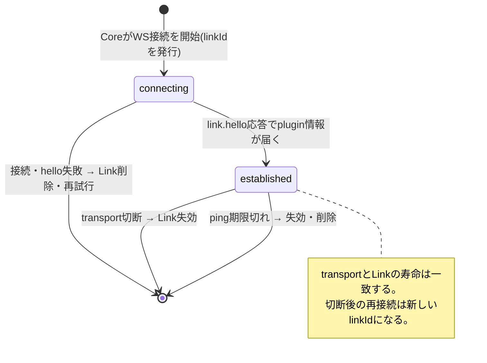
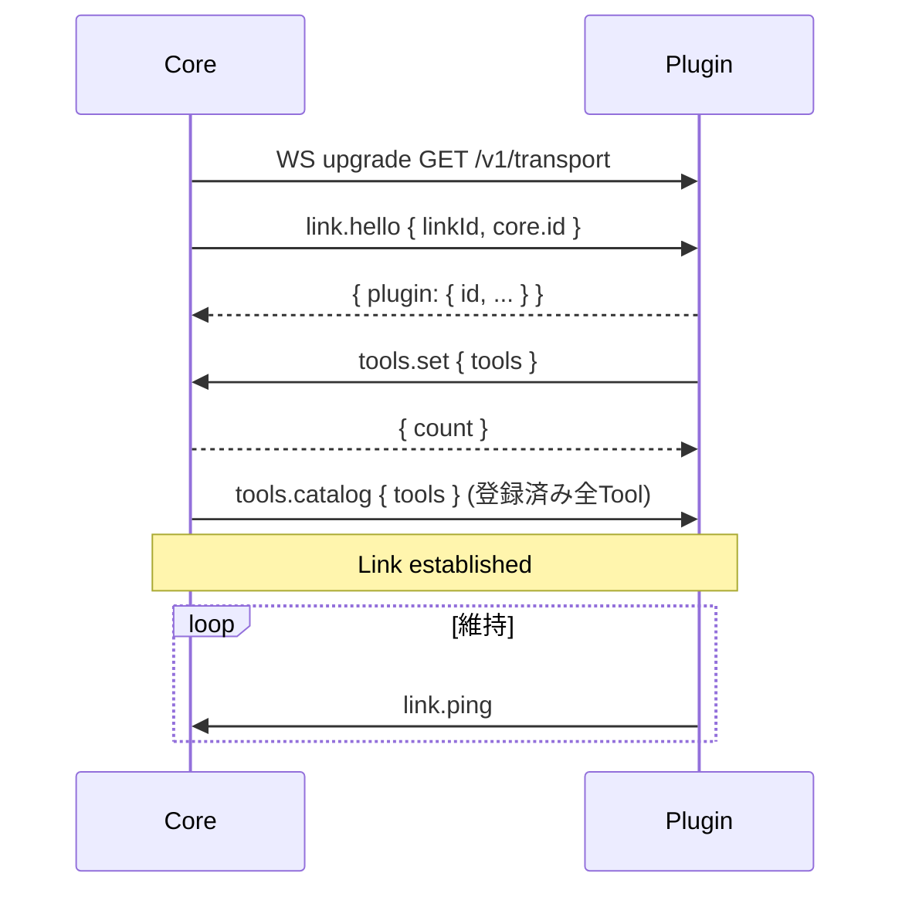

## 当事者と範囲

Core と Plugin の双方が実装する通信境界。Core↔Plugin通信は **WebSocket + JSON-RPC 2.0 の1本に統一**する（`docs/decisions/00010`）。メッセージ形式と全operationは `docs/contracts/00002`、呼び出し形態は `docs/contracts/00003`、本contractは接続手順とLinkのライフサイクルを規定する。

- Pluginプロセスは外部起動を前提とする（Coreはspawnしない）
- Panel ↔ Plugin の通信は本契約の対象外。Pluginのフロントエンド⇄バックエンド間はWS・WebRTC・GraphQL等を自由に選んでよい
- 接続開始は必ず **Core → Plugin**。**PluginはCoreのURL・Domainを知らない**（接続前でも接続後でも）。Pluginは待受と応答だけを行う

## Endpoint

- **Pluginは `ws://<host>:<port>`（リモートなら `wss://`）のWS server**として待受し、Coreからのupgrade `GET /v1/transport` を受け付ける。PluginのHTTP面はこのupgrade受付のみで、REST operationは持たない
- **Coreは `http://<host>:<port>` のREST server**として待受するが、これはPlugin向けではなく**管理・UI向けAPI**（後述）。PluginがこのURLを知ることはない
- CoreとPluginは別マシンにあり得る。到達性は利用者がネットワーク構成で確保する（`docs/decisions/00010`）
- TLS・認証は未解決の別設計事項。MVPはloopback・認証トークン無し

## 共通規則

- transport上のメッセージはすべて **JSON-RPC 2.0**（`docs/contracts/00002`）
- 本書のJSON例は説明用であり、フィールドの順序・余分な空白に意味はない
- 未知のフィールドを受け取った側は無視してよい（forward compatibility）

### バージョン

- **URL prefix `/vN/` がプロトコル版である**（`v1`・`v2`…の整数版）。transportのupgrade path `/v1/transport` にもこのprefixが付く
- version情報はメッセージbodyに持たない。pathだけがversion情報源
- **互換性ルール**: 同じ `/vN/` 同士は互換。破壊的変更はversionを進めて `/v2/` 等を新設する
- サポート外の `/vN/`（Nは数字）へのupgrade・リクエストは、upgrade受理前にHTTP **`426 protocol_mismatch`** で応答する。Pluginは `/v1/` 以外の `/vN/` を知らない場合426を返す
- `/vN/` 以外の未知pathは `404` のエラーbody（下表の形）を返す

### エラー応答

transport確立前のHTTP段階では、次の形のbodyで返す。

```jsonc
{ "error": { "code": "<error-code>", "message": "<人間向け説明文>" } }
```

| HTTP | code | 発生条件 |
|---|---|---|
| 400 | `invalid_params` | 必須フィールドの欠落・型の不一致（管理REST API含む） |
| 400 | `invalid_endpoint` | `POST /v1/plugins` のendpointがws(s) URLでない |
| 404 | `unknown_endpoint` | 存在しないoperation・path |
| 409 | `duplicate_endpoint` | `POST /v1/plugins` で既知のendpointを再登録 |
| 426 | `protocol_mismatch` | サポート外の `/vN/` prefix へのリクエスト |

transport確立後のエラーはJSON-RPC error objectで返す（`docs/contracts/00002`）。`message` は人間向けで自由。実装は `code` とHTTPステータスのみで判定すること。

## 用語

Link・linkId・Transport 等の定義は `docs/glossary.md` を正本とする。

- **Link**: CoreとPluginが確立する1つの接続・登録単位。`linkId` がLink識別とTool呼び出しの宛先を兼ねる
- **Transport**: Linkと1対1で結ばれたWebSocket通信路。**transportの寿命とLinkの寿命は一致する**（切断 = Link失効）

## Plugin Endpointの解決

Coreは起動設定（`plugumi.json` の `plugins[]`）でPlugin Endpoint一覧を持ち、各EndpointへのWS接続を試みる。実行中に `POST /v1/plugins`（管理REST）または `plugins.add`（transport経由）で追加登録もできる。

- 接続不能なEndpointへの接続は再試行を続ける（間隔は実装詳細・推奨値は後述）
- 動的登録はランタイムのみ有効で、再起動で消える
- Endpointの形式は `ws://<host>:<port>` または `wss://<host>:<port>`（pathは持たない。接続先pathは `/v1/transport` に固定）

## Linkのライフサイクル





1. CoreはPlugin EndpointへWS接続を開始し、`link.hello` requestを送る。Coreが払い出した `linkId` と `core.id` を伝え、Pluginは自身の識別情報を返す
2. Pluginは `tools.set` でこのLinkが提供するTool一覧を宣言する（接続直後と宣言変更時）
3. CoreはLink確立後と登録内容の変化ごとに `tools.catalog` notificationを全Linkへ送り、現在の全Tool一覧を知らせる
4. Linkは `link.ping` の定期送信で半開きを検出する。Coreは最終pingから失効期限を超えたLinkを削除する
5. **transport切断 = Link失効**。Tool宣言・紐付くcallはすべて消える（link-scoped）。再接続は新しいWS接続と `link.hello` からやり直し、新 `linkId` が払い出される
6. 同じ `core.id` からの新しいhelloは、同じ `core.id` の旧Linkを失効させてから差し替える（plugin再起動・Core再接続時）

## 確立時のoperation

transport上の各operationの詳細なparams・responseは `docs/contracts/00002` に規定する。ここでは確立順序だけを示す。

| method | 方向 | 役割 |
|---|---|---|
| `link.hello` | Core→Plugin request | linkId払い出し・plugin情報の取得 |
| `tools.set` | Plugin→Core request | Tool宣言のアトミック置換 |
| `tools.catalog` | Core→Plugin notification | 登録中の全Tool一覧のpush |
| `link.ping` | Plugin→Core notification | Link維持信号（30秒間隔） |

- `tools.set`・`link.ping` はtransportがLinkに紐付いているため `linkId` をparamsに持たない
- `link.hello` の応答が返る前に `tools.set` が届く場合に備え、CoreはWS接続開始前にLinkを登録する（実装上の要求として規定）

## Core管理REST API（Plugin向けではない）

Host・人間が使う管理面。PluginはこのAPIを使わない・知らない。

| operation | 用途 |
|---|---|
| `POST /v1/plugins` | Plugin Endpointの動的登録（`{"endpoint": "ws://…"}`。受理のみで接続は非同期） |
| `POST /v1/plugins/list` | 登録済みEndpoint一覧（linkId・pluginId付き） |
| `POST /v1/tools/list` | 登録中の全Tool一覧（人間・UI向け確認用） |
| `GET /openapi.json`・`GET /docs` | OpenAPI 3.1と閲覧UI |

- 管理RESTのエラー応答は上表のHTTPエラー形に従う
- 認証なしのため待受はloopback必須（MVPの安全性前提）

## IDの形式

| ID | 形式 | 発行者 | 一意性の範囲 |
|---|---|---|---|
| `linkId` | `link-<UUIDv4>` | Core | Core内で一意。再利用しない |
| `core.id` | 不透明な文字列 | Core | Core再起動・複数Core間で実質一意（推奨: 生成して永続化） |
| `callId` | 発行側の任意文字列（推奨 `plugin-N`/`core-N`） | 各conn送信側 | conn・送信方向ごと |

`core.id` は宛先ではなく識別用の不透明な値。Pluginはこれを使って「同じCoreからの再hello」を検出するが、そこからCoreへ接続する手段は持たない。

## 時間に関する定数

以下はMVP実装の**推奨値**であり、適合に必須ではない。ただし関係ルール（下記）は維持すること。

| 定数 | 推奨値 | 関係ルール |
|---|---|---|
| ping間隔 | 30秒 | 失効期限を下回ること |
| 失効期限 | 90秒 | ping間隔の概ね3倍（数回分の取りこぼしを許す） |
| 接続再試行間隔 | 3秒 | — |
| hello応答timeout | 5秒 | — |
| tools.call転送timeout | 120秒 | — |

## セキュリティと適合性

- **安全性の前提**: MVPはloopbackのみで、外部ネットワークから到達できないことが前提。Coreと同じユーザー権限のプロセスは本契約上すべて信頼できる呼び出し元とみなす（`docs/decisions/00001` の信頼モデルと整合）。Coreの管理REST待受はloopbackを要求する
- Plugin Endpointがリモートの場合、TLS（`wss://`）・認証は別設計事項として必須になる（未解決）
- 1 Pluginは複数Coreからの接続を受け付け得る。LinkはCoreごとに独立し、`linkId` はCore内の名前空間で衝突しない
- **Pluginが外部へ接続する経路は存在しない**。helloもtransportもCoreから来るものを受け付けるだけである

## 適合ルール

独立実装が本contractに適合するには、次を満たす。

- Core側実装は Plugin EndpointへのWS接続開始・`link.hello` 発行・linkId払出・ping維持・失効判定・endpoint登録・`tools.set` 受理・`tools.catalog` 送信の全operationを提供すること
- Plugin側実装は `/v1/transport` のupgrade受付・`link.hello` 応答・`tools.set`/`link.ping` 送信を行えること。CoreのURL・Domainを保持しないこと
- エラー応答は上記のコード・HTTPステータスと一致すること
- `linkId`・`callId`の形式は実装側の自由ではなく上表に従うこと（`link-`prefix・UUIDv4）

## 未定と未解決の問い

**未定（実装者の自由）:**

- Plugin内部の実装構造（言語・並行モデル・永続化）
- pingの送信間隔・失効期限の具体的値（推奨値の範囲で）
- `core.version`・`plugin.version` の解釈

**未解決の問い（後で決める）:**

- `toolPath` の構造（`seg/seg` 階層か、flat文字列か）
- `link.ping` の間隔・失効期限を適合必須値に格上げするか
- 明示的な終了操作（`link.bye` 等）を定義するか
- リモート接続のTLS・認証・権限管理（`wss://` 前提の別contract）
