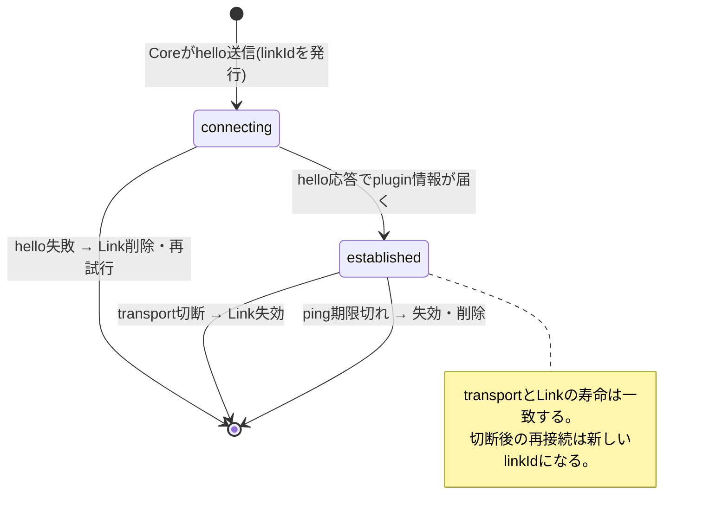
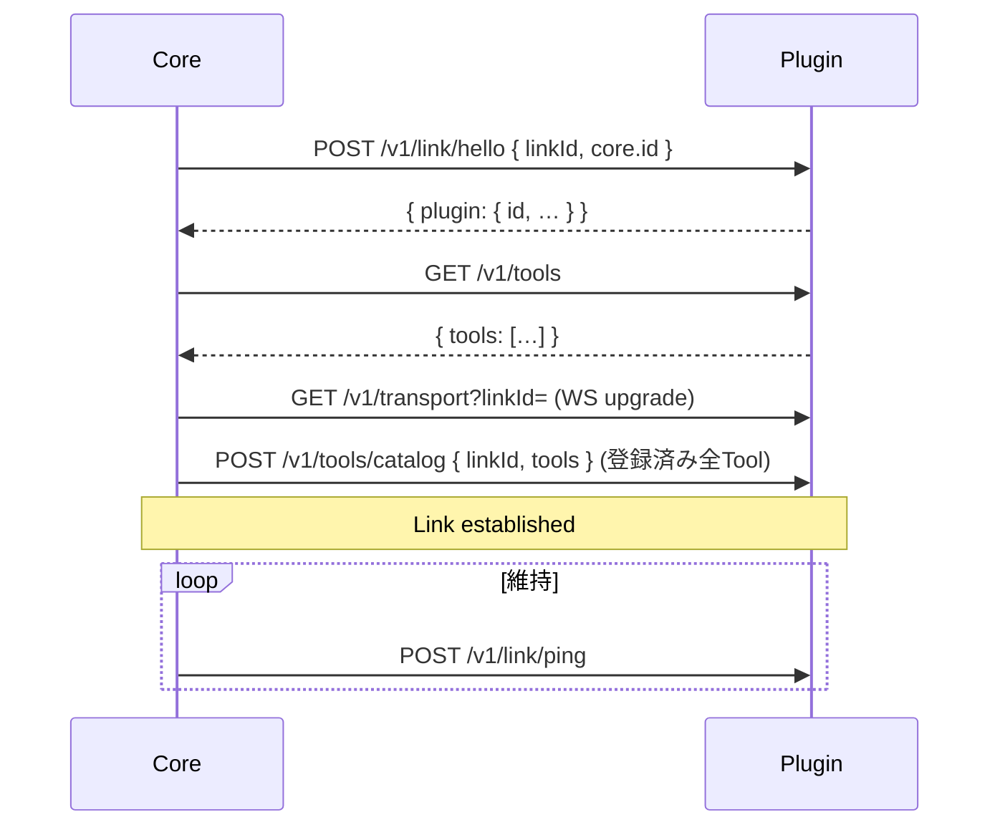

> 現行試作が使う旧v1の接続契約。新規設計には[v2草案](00004-plugin-client-protocol.md)を参照する。

## 当事者と範囲

Core と Plugin の双方が実装する通信境界。**共通規格（登録・検査系）はCore→PluginのREST、Tool呼び出しの流路だけをWS + JSON-RPC 2.0とする**（`docs/decisions/00010`）。WS上のメッセージ形式は `docs/contracts/00002`、呼び出し形態は `docs/contracts/00003`、本contractは接続手順とLinkのライフサイクルを規定する。

- Pluginプロセスは外部起動を前提とする（Coreはspawnしない）
- Panel ↔ Plugin の通信は本契約の対象外。Pluginのフロントエンド⇄バックエンド間はWS・WebRTC・GraphQL等を自由に選んでよい
- 接続開始は必ず **Core → Plugin**。**PluginはCoreのURL・Domainを知らない**（接続前でも接続後でも）。Pluginは待受と応答だけを行う

## Endpoint

- **Pluginは `http://<host>:<port>`（リモートなら `https://`）のHTTP server**として待受し、下表のREST operationとWS upgradeを受け付ける
- **Coreは `http://<host>:<port>` のREST server**として待受するが、これはPlugin向けではなく**管理・UI Host・TUI向けAPI**（後述）。PluginがこのURLを知ることはない
- CoreとPluginは別マシンにあり得る。到達性は利用者がネットワーク構成で確保する（`docs/decisions/00010`）
- TLS・認証は未解決の別設計事項。MVPはloopback・認証トークン無し

### ローカルPluginの待ち受け

- ローカルで起動するMVPのPluginは、待ち受けを指定しなければ `http://127.0.0.1:0` を使う。ポート `0` はOSによる空きポートの割り当てを意味する
- `--port <port>` で `127.0.0.1` の待受ポートを指定できる。ホストも指定する場合は、代わりに `--listen <url>` を使う
- 指定したポートで待ち受けられなければ起動に失敗し、別のポートには切り替えない
- Pluginは待ち受け開始後に、実際のポートを含むURLを表示する。Coreに登録するEndpointには、`0` ではなく実際のポートを指定する

### ローカルPluginの自己登録

ローカルで起動するPluginは、待ち受け開始後に自分をローカルregistryへ登録する。CoreやTUIはこの記録とstatus endpointで、起動中のPluginを発見する。登録はCore↔Plugin契約ではなくOSユーザー単位の管理機構で、特定のCoreとは無関係。Pluginの起動・停止がCoreに従属しない方針は変わらない。

- 記録は `<ユーザーのキャッシュディレクトリ>/plugumi/plugins/` に書く（`os.UserCacheDir()` と同じ場所）
- ファイル名はEndpoint URLの英数以外を `-` に置き換えて `.json` を付ける。同じURLは同じファイル名になり、再起動で上書きされる
- 読みかけの不完全ファイルを見せないよう、別名で書いてからrenameする
- 記録の形: `{ "name": "standard", "url": "http://127.0.0.1:50309", "id": "plugin-…", "version": "0.1.0", "pid": 12345, "log": "<path>" }`
  - `id` はプロセスごとの不透明な識別子（Coreのinstance id相当）
  - `log` はPlugin自身のログファイルのパス（省略可）。1プロセスが複数Coreに繋がり得るため、ログはCoreではなくPluginの記録に持つ。パスはPluginが自分で決めて `<キャッシュディレクトリ>/plugumi/logs/` に書く
- status endpoint: `GET /_plugumi/plugin`（HEADも応答する）が `204` と `Plugumi-Plugin-Instance` ヘッダ（=`id`）を返す。Linkを作らずに生存と同一性だけを返す
- 一覧に出すのは、記録がありstatus endpointが同じ `id` で応答するものだけ。異常終了で残った記録はprobeで除外される
- 正常終了では自分の記録を消す

### Plugin catalog（ユーザー登録の定義）

実行中registryとは別に、ユーザーが登録した定義の一覧を `<ユーザーのconfigディレクトリ>/plugumi/plugins.json` に持つ（`os.UserConfigDir()`。ユーザー入力なのでcacheには置かない）。

- 定義の形: `{ "name": "standard", "endpoint": "http://…", "command": "…" }`。`endpoint`と`command`の少なくとも一方が必須
  - `command` は `plugumi plugins start <name>` やTUIからplugumiがdetached起動するシェルコマンド
  - `endpoint` は外部起動済みPluginへの接続先
- catalogは「まだ起動していなくても存在を知っているPlugin」の一覧。実行中かどうかはregistry側のprobeで判断し、名前で突き合わせる
- 操作: `plugumi plugins`（catalog∪実行中の一覧）、`plugumi plugins add|rm|start <name>`

## Plugin REST operations

PluginのHTTP serverが受け付けるoperation。全てCore→Plugin方向。

| operation | 役割 |
|---|---|
| `POST /v1/link/hello` | Link確立: linkId払い出し・plugin情報取得 |
| `POST /v1/link/ping` | Link維持の生存確認（Core→Pluginにprobe） |
| `GET /v1/tools` | PluginのTool宣言一覧を返す |
| `POST /v1/tools/catalog` | 登録中の全Tool一覧のpush受信 |
| `GET /v1/transport?linkId=` | Tool呼び出し用WS接続のupgrade受付 |

### `POST /v1/link/hello`

```jsonc
// request
{ "linkId": "link-<UUIDv4>", "core": { "id": "<core.id>", "version": "<semver?>" } }
// response 200
{ "plugin": { "id": "agent", "version": "0.1.0", "name": "…" } }
```

- Coreが払い出した `linkId` と不透明な識別子 `core.id` を伝え、Pluginは自身の識別情報を返す
- 同じ `core.id` からの再helloは、その `core.id` の旧Linkを失効させてから差し替える（plugin再起動・Core再接続時。別CoreのLinkは生かす）

### `POST /v1/link/ping`

```jsonc
// request
{ "linkId": "link-<UUIDv4>" }
// response 200
{ }
```

- 生存確認probe。Coreが定期的に送り、応答成功でそのLinkの `lastPing` を更新する
- 応答失敗・不明なlinkIdはLink失効に向けてカウントされる

### `GET /v1/tools`

```jsonc
// response 200
{ "tools": [ { "toolPath": "echo", "kind": "sync" }, … ] }
```

- Pluginが提供するTool宣言を返す。CoreはLink確立後にpullする
- `kind` は `sync | async`（省略時 `sync`）。宣言の構造は `docs/contracts/00003`
- `toolPath` はPluginの宣言内で一意な空でない文字列、`kind` は `sync | async`（省略時 `sync`）であること。これらを満たさない宣言（空・重複・enum外のkind）は契約違反であり、CoreはLink確立を拒否する（接続試行は失敗として再試行される）

### `POST /v1/tools/catalog`

```jsonc
// request
{
  "linkId": "link-<受信側PluginのUUIDv4>",
  "tools": [ { "linkId": "link-<Tool提供側PluginのUUIDv4>", "toolPath": "echo", "kind": "sync" } ]
}
// response 200
{ }
```

| フィールド | 型 | 必須 | 意味 |
|---|---|---|---|
| `linkId` | string | はい | catalogを受け取るPluginのLink。Pluginは複数のCoreから受け取ったcatalogをこのIDで区別する |
| `tools` | array | はい | Coreに現在登録されている全Tool。0件の場合は `[]`。Pluginは指定されたLinkのcatalogを全置換する |
| `tools[].linkId` | string | はい | 各Toolを提供するPluginのLink。呼び出し時の `target.linkId` として使う |

- `tools` の各要素には `linkId` に加えてTool宣言のフィールドを含める
- 必須フィールドの欠落・型の不一致は `400 invalid_params`、受信側に存在しないトップレベルの `linkId` は `404 unknown_link` とする
- 送信契機: Link確立・Link失効・Tool宣言の変化（`GET /v1/tools` の結果が変わったとき）

### `GET /v1/transport?linkId=`

- Tool呼び出し用WS接続のupgrade受付。`linkId` queryで既存Linkに紐付ける
- このWS上を流れるのは `tools.call` 系のみ（`docs/contracts/00002`）

## 共通規則

- 本書のJSON例は説明用であり、フィールドの順序・余分な空白に意味はない
- 未知のフィールドを受け取った側は無視してよい（forward compatibility）

### バージョン

- **URL prefix `/vN/` がプロトコル版である**（`v1`・`v2`…の整数版）。transportのupgrade path `/v1/transport` にもこのprefixが付く
- version情報はメッセージbodyに持たない。pathだけがversion情報源
- **互換性ルール**: 同じ `/vN/` 同士は互換。破壊的変更はversionを進めて `/v2/` 等を新設する
- サポート外の `/vN/`（Nは数字）へのリクエスト・upgradeは、受理前にHTTP **`426 protocol_mismatch`** で応答する
- `/vN/` 以外の未知pathは `404` のエラーbody（下表の形）を返す

### エラー応答

HTTP段階では、次の形のbodyで返す。

```jsonc
{ "error": { "code": "<error-code>", "message": "<人間向け説明文>" } }
```

| HTTP | code | 発生条件 |
|---|---|---|
| 400 | `invalid_params` | 必須フィールドの欠落・型の不一致 |
| 400 | `invalid_endpoint` | `POST /v1/plugins` のendpointがhttp(s) URLでない |
| 404 | `unknown_endpoint` | 存在しないoperation・path、または未登録endpointへの `POST /v1/plugins/remove` |
| 404 | `unknown_link` | `linkId` が現存しない（transport upgrade・ping等） |
| 409 | `duplicate_endpoint` | `POST /v1/plugins` で既知のendpointを再登録 |
| 426 | `protocol_mismatch` | サポート外の `/vN/` prefix へのリクエスト |

transport確立後（WS上）のエラーはJSON-RPC error objectで返す（`docs/contracts/00002`）。`message` は人間向けで自由。実装は `code` とHTTPステータスのみで判定すること。

## 用語

Link・linkId・Transport 等の定義は `docs/glossary.md` を正本とする。

- **Link**: CoreとPluginが確立する1つの接続・登録単位。`linkId` がLink識別とTool呼び出しの宛先を兼ねる
- **Transport**: Linkと1対1で結ばれたWebSocket通信路。**transportの寿命とLinkの寿命は一致する**（切断 = Link失効）

## Plugin Endpointの解決

Coreは起動設定（`plugumi.json` の `plugins[]`）でPlugin Endpoint一覧を持ち、各Endpointへの接続を試みる。実行中に `POST /v1/plugins`（管理REST）で追加登録もできる。

- Endpointへの接続確立（hello〜tools pull〜transport upgradeの全段階）に失敗した場合は再試行を続ける（間隔は実装詳細・推奨値は後述）。HTTPエラー応答も同じく再試行対象
- 動的登録はランタイムのみ有効で、再起動で消える
- Endpointの形式は `http://<host>:<port>` または `https://<host>:<port>`（path・query・fragmentは持たない。`plugumi.json` と `POST /v1/plugins` の両方で検査する）

## Linkのライフサイクル





1. Coreは `POST /v1/link/hello` でLinkを確立する。払い出した `linkId` と `core.id` を伝え、Pluginは自身の識別情報を返す
2. Coreは `GET /v1/tools` でTool宣言をpullする（宣言の変化検知は下記「未解決」）
3. Coreは `GET /v1/transport?linkId=` でWSをupgradeし、Tool呼び出し用のtransportをLinkに結ぶ
4. Coreは `POST /v1/tools/catalog` で現在の全Tool一覧をPluginへpushする（Link確立時と内容変化ごと）
5. Coreは `POST /v1/link/ping` の定期送信で半開きを検出する。最終成功から失効期限を超えたLinkを削除する
6. **transport切断 = Link失効**。Tool宣言・紐付くcallはすべて消える（link-scoped）。再接続はhelloからやり直し、新 `linkId` が払い出される

## Core管理API（Plugin向けではない）

UI Host・人間・TUIが使う管理面。PluginはこのAPIを使わない・知らない。`GET /v1/call` だけはRESTではなくWS upgradeで、caller channelとして後述する。

| operation | request | response |
|---|---|---|
| `POST /v1/plugins` | `{"endpoint": "http://…"}` | `{"endpoint": "…"}`。受理のみで接続は非同期 |
| `POST /v1/plugins/remove` | `{"endpoint": "http://…"}` | `{"endpoint": "…"}`。Link失効・再試行loop停止は非同期。未登録endpointは404 `unknown_endpoint` |
| `POST /v1/plugins/list` | `{}` | `{"plugins": [{"endpoint","linkId"?,"pluginId"?}]}`。Link未確立の再試行中は `linkId`/`pluginId` を省略 |
| `POST /v1/tools/list` | `{}` | `{"tools": […]}`。各要素は `linkId` + Tool宣言（`toolPath`/`kind`/`description`?/`tags`?/`inputSchema`?/`outputSchema`?） |
| `GET /v1/call` | — | caller向けTool呼び出しchannelのWS upgrade（後述） |
| `GET /openapi.json`・`GET /docs` | — | OpenAPI 3.1と閲覧画面 |

- 管理RESTのエラー応答は上表のHTTPエラー形に従う
- huma等のframeworkが返すHTTP層エラー（`405 Method Not Allowed`・`415 Unsupported Media Type` 等、domain errorでないもの）は `code` にHTTP status textを使う。上表はdomain errorの一覧
- humaが生成する応答bodyには `"$schema"` フィールドが付き得る（OpenAPI成果物。受け手は未知フィールドとして無視してよい）
- 認証なしのため待受はloopback必須（MVPの安全性前提）
- `/v1/call` はWS upgradeのためhuma（OpenAPI）には登録せずmux直結で実装する。**`GET /openapi.json` のspecには含まれない**ので、caller channelを使う実装は本contractを直接参照すること

### caller channel（`GET /v1/call`）

Pluginでない呼び出し元（TUI・UI Host・スクリプト）がToolを呼ぶためのWS接続。Linkには紐付かず、connの寿命=接続の寿命。

- upgrade成功後は `docs/contracts/00003` の **caller側** をそのまま喋る: `tools.call` request（`{target:{linkId,toolPath},input}`）を送り、responseと `tools.call.chunk`/`tools.call.result` notificationを受け取り、`tools.call.close` notificationを送れる
- このWS上を流れるのも `tools.call` 系のみ（Plugin transportと同じ制約）
- callerが送れるrequestは `tools.call` のみ。他methodはJSON-RPC `-32601`
- callerはLinkを持たないため `POST /v1/tools/catalog` のpush対象外。一覧が要るcallerは管理REST `POST /v1/tools/list` で取得する

## IDの形式

| ID | 形式 | 発行者 | 一意性の範囲 |
|---|---|---|---|
| `linkId` | `link-<UUIDv4>` | Core | Core内で一意。再利用しない |
| `core.id` | 不透明な文字列 | Core | Core再起動・複数Core間で実質一意（推奨: 生成して永続化） |
| `callId` | 発行側の任意文字列（推奨 `plugin-N`/`core-N`/`caller-N`/`tui-N` 等、接続役割が分かるprefix） | 各conn送信側 | conn・送信方向ごと |

`core.id` は宛先ではなく識別用の不透明な値。Pluginはこれを使って「同じCoreからの再hello」を検出するが、そこからCoreへ接続する手段は持たない。

## 時間に関する定数

以下はMVP実装の**推奨値**であり、適合に必須ではない。ただし関係ルール（下記）は維持すること。

| 定数 | 推奨値 | 関係ルール |
|---|---|---|
| ping間隔 | 30秒 | 失効期限を下回ること |
| ping応答timeout | 5秒 | — |
| 失効期限 | 90秒 | ping間隔の概ね3倍（数回分の取りこぼしを許す） |
| 失効判定tick | 15秒 | 失効期限以下でよい |
| 接続再試行間隔 | 3秒 | — |
| hello応答timeout | 5秒 | — |
| `GET /v1/tools` 応答timeout | 5秒 | — |
| `POST /v1/tools/catalog` 送信timeout | 10秒 | — |
| tools.call転送timeout | 120秒 | — |

## セキュリティと適合性

- **安全性の前提**: MVPはloopbackのみで、外部ネットワークから到達できないことが前提。Coreと同じユーザー権限のプロセスは本契約上すべて信頼できる呼び出し元とみなす（`docs/decisions/00001` の信頼モデルと整合）。Coreの管理REST待受はloopbackを要求する
- Plugin Endpointがリモートの場合、TLS（`https://`）・認証は別設計事項として必須になる（未解決）
- 1 Pluginは複数Coreからの接続を受け付け得る。LinkはCoreごとに独立し、`linkId` はCore内の名前空間で衝突しない
- **Pluginが外部へ接続する経路は存在しない**。helloもtransportもCoreから来るものを受け付けるだけである

## 適合ルール

独立実装が本contractに適合するには、次を満たす。

- Core側実装は Plugin Endpointへの `POST /v1/link/hello` ・ `GET /v1/tools` ・ `POST /v1/tools/catalog` ・ `POST /v1/link/ping` ・ `GET /v1/transport` upgrade・linkId払出・失効判定・endpoint登録の全operationを提供すること
- Plugin側実装は上表のREST operation全てと `/v1/transport` のupgrade受付を行えること。CoreのURL・Domainを保持しないこと。`toolPath` の一意性を宣言で守ること
- エラー応答は上記のコード・HTTPステータスと一致すること
- `linkId`・`callId`の形式は実装側の自由ではなく上表に従うこと（`link-`prefix・UUIDv4）

## 未定と未解決の問い

**未定（実装者の自由）:**

- Plugin内部の実装構造（言語・並行モデル・永続化）
- pingの送信間隔・失効期限の具体的値（推奨値の範囲で）
- `core.version`・`plugin.version` の解釈

**未解決の問い（後で決める）:**

- `toolPath` の構造（`seg/seg` 階層か、flat文字列か）
- **Tool宣言の動的変更の伝え方**。`GET /v1/tools` はpull型なので、宣言が実行中に変わってもPluginから通知する術がない（MVPはLink確立時の1回pull。変更を伝えるにはtransport上のヒント通知か、明示的な再helloが要る）
- `link.ping` の間隔・失効期限を適合必須値に格上げするか
- 明示的な終了操作（`link.bye` 等）を定義するか
- リモート接続のTLS・認証・権限管理（`https://` 前提の別contract）
