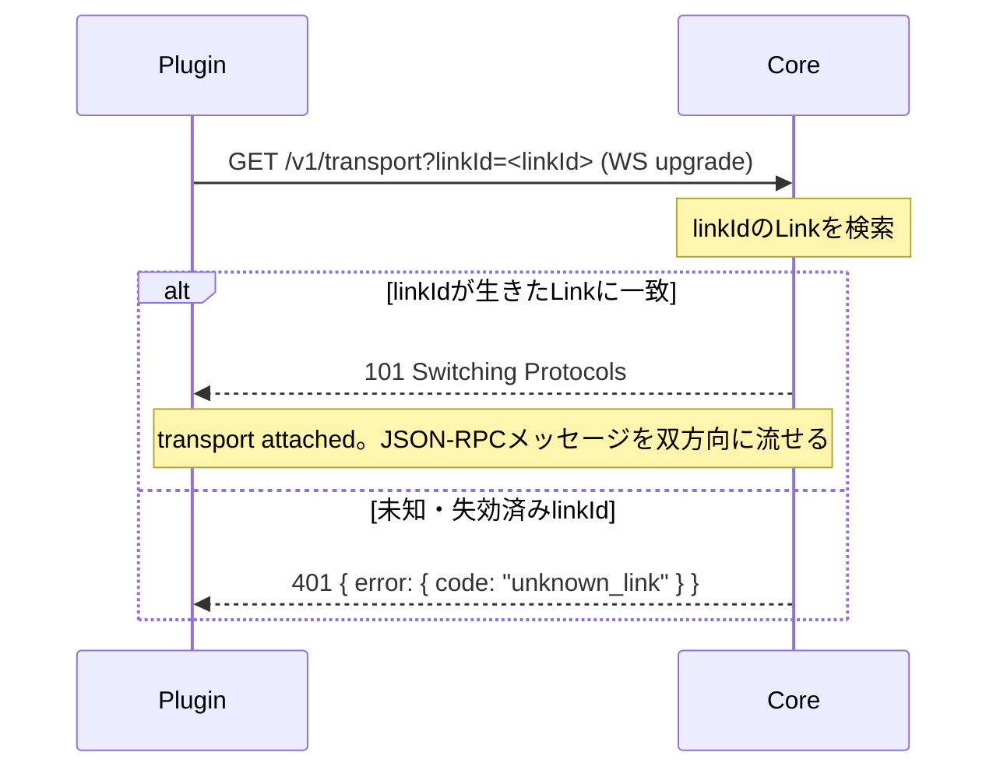
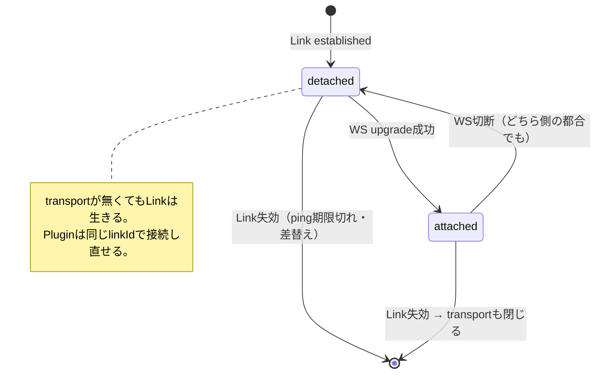

## 当事者と範囲

Linkの配下に確立される双方向のtransport。REST（`docs/contracts/00001`）ではPlugin→Coreへのpush・途中出力を表せないため、永続的な双方向路を別transportで持つ。

- **Plugin → Core 方向にWS接続する**。Pluginは `link.hello` で得た `core.url` 宛てに接続を開く
- transport上のメッセージ形式は **JSON-RPC 2.0**（request/response/notification・id相関・error形状を再利用）
- 流れるmethod/notification（`tools.call` 等）の具体的な形は `docs/contracts/00003` で定義する。本contractはtransportの確立・寿命・意味論を規定する

## なぜこの形か

- Plugin→Coreの送信は「いつでも・何回でも・継続的に」起こる（Tool実行中の中間出力等）。RESTのrequest/responseでは1送信1HTTPとなり、順序付きで連続する出力を表しにくい
- 一度貼ったtransport上を双方向に流せるため、Core→Pluginの呼び出し・通知も同じ路に載せられる
- 詳細な採用理由（gRPC・Connectとの比較）は `docs/decisions/00007`

## 確立

- transportのURLは `core.url` のスキームを `http://` → `ws://`（`https://` → `wss://`）に置き換えた `GET /v1/transport?linkId=<linkId>`
- `linkId` が生きたLinkに一致しなければ、upgrade前に `401 unknown_link` のJSONエラーbodyで拒否する
- transportは1つのLinkに最大1本。同じLinkへの再接続は旧transportを差し替える（実装上の要求として規定）
- transportの確立は `link.hello` 成立後にPluginが任意のタイミングで行う。確立するまでCoreはそのLink宛の呼び出しを転送できない

## 寿命: transportとLinkは別のライフサイクル

- **transport切断はLink失効とは別**。transportが切れてもLink・Tool宣言・呼び出し元の関係は残り、Pluginは同じ `linkId` で接続し直せる
- Linkの寿命はREST側の `link.ping` が管理する（`docs/contracts/00001`）。transportの有無はLink失効判定に関係しない
- Link失効時は紐付くtransportも閉じる
- Pluginはtransport切断を検知したら、Linkが生きている限り再接続を試みてよい（間隔は実装詳細・推奨3秒）

## メッセージ意味論

- 同一transport上のメッセージは**到着順が保証される**
- ただし **transportの到着順とRPCの処理完了順は別物**である。並行処理されるrequestは処理順が入れ替わり得るため、「受信順=完了順」を前提にしてはならない。順序保証が要る処理は呼び出し側がid相関で追跡する
- transportは**両方向**にrequest・notification・responseを流せる。Plugin→CoreもCore→Pluginも、requestを発する側・応答する側の両役を同じconn上で持ち得る
- JSON-RPC `id` は「接続ごと・送信方向ごと」の空間で一意ならよい。相手が発行したidと自分が発行するidは別空間（`docs/contracts/00003`「idの一意性」）
- 配送保証: transport上の1メッセージは送達までに失われない（WSの性質上）。切断中のメッセージは再送されない。再送が要る意味論は `tools.call` 等の上位で扱う

## エラー

| 条件 | 応答 |
|---|---|
| `linkId` 未知・失効 | upgrade前 `401 unknown_link` |
| WS upgrade失敗 | HTTPエラー（upgrade完了前のためWSメッセージではない） |
| upgrade後のメッセージ形違反 | JSON-RPC error（`-32700` parse error等） |

## セキュリティと適合性

- `docs/contracts/00001` と同じloopback・認証なし前提
- transportは `linkId` を知っていれば接続できる。MVPでは「`linkId` を知る=そのLinkのpluginである」という信頼モデル。認証は後続contractの設計事項
- WS origin policy・サブプロトコル等の詳細は実装者の自由（MVPは全origin許可でよい）

## 適合ルール

- Plugin側実装は `GET /v1/transport?linkId=` でupgradeし、JSON-RPCメッセージを両方向に処理できること
- Core側実装は `linkId` 検証・transportのLink紐付け・切断時のLink保持（Link失効とは別処理）を行うこと
- transport切断後、同じlinkIdで再度upgradeできること

## 未定と未解決の問い

**未定（実装者の自由）:**

- transport再接続の間隔・戦略
- transport上でのJSON-RPCメッセージのフレーム分割・バッチ送信

**未解決の問い（後で決める）:**

- 切断・再接続の扱い（未配送メッセージ・配送保証・再送の上位意味論）
- フロー制御（大量の途中出力時の背圧）
- transportの認証（`linkId` 以外のクレデンシャル）
- transportのWSサブプロトコル名を規定するか
