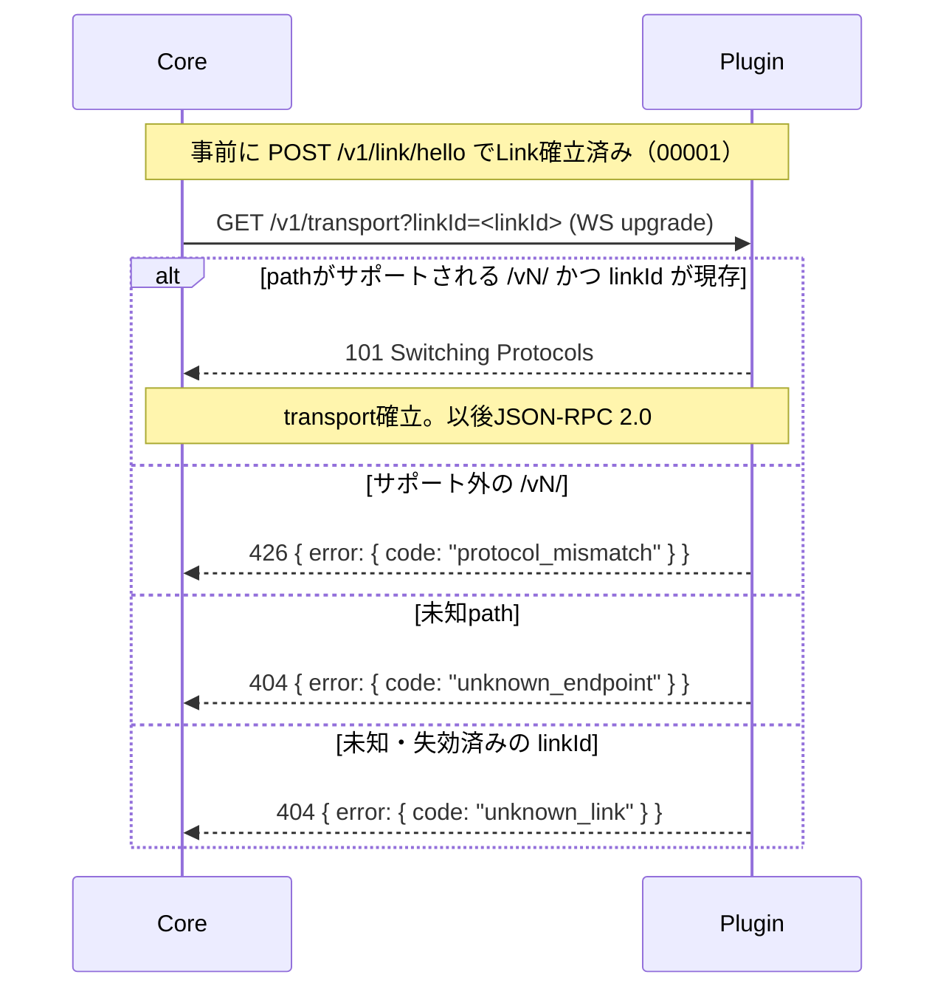
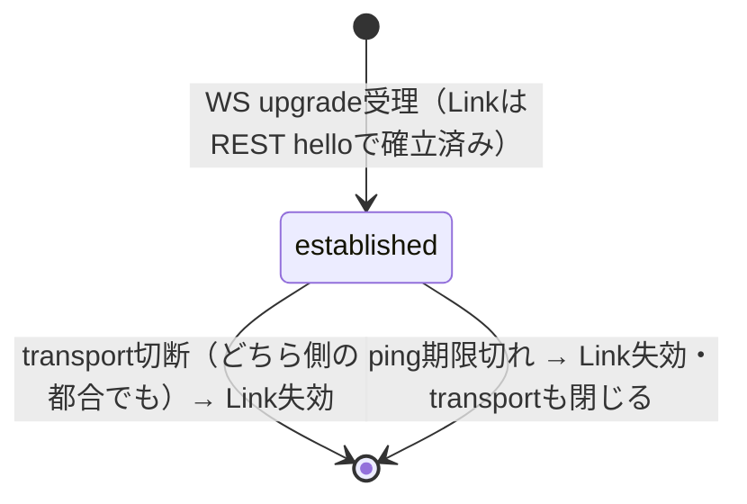

## 当事者と範囲

Linkに1対1で結ばれた、Tool呼び出し専用のWS通信路（`docs/contracts/00001`）。本contractはtransportの確立と、その上を流れるメッセージ形を規定する。

- **Core → Plugin 方向にWS接続する**。Coreは `http(s)://<plugin-endpoint>/v1/transport?linkId=` へupgradeを開く。Pluginはupgradeを受け付けるだけで、接続先を知らなくてよい
- transport上のメッセージ形式は **JSON-RPC 2.0**（request/response/notification・id相関・error形状を再利用）
- **transport上を流れるのは `tools.call` 系のみ**。登録・検査系（hello・ping・tools取得・catalog push）はPlugin RESTで行う（`docs/contracts/00001`）
- `tools.call` とその notification の詳細は `docs/contracts/00003` で定義する

## なぜこの形か

- Tool実行は「いつでも・何回でも・継続的に」起こる（中間出力・長時間実行・中断）。WS上のJSON-RPCなら順序付きで連続する送信を1接続に載せられる
- 登録・検査系はREST（`docs/contracts/00001`）に置くことで、Plugin側実装の大半はOpenAPI codegenで生成でき、WS実装が要るのはcall路だけになる（`docs/decisions/00010`）
- Plugin側はWS upgradeの受付とJSON-RPC応答だけでよく、client・再接続・接続先設定を実装する必要がない

## 確立



- transportのpathは `/v1/transport` に固定し、`linkId` queryで既存Linkに紐付ける。Endpoint（`http(s)://<host>:<port>`）はCoreの設定で決まり、pathは契約で固定する
- upgrade受理前の拒否はHTTP応答（`426`・`404`）で返す。受理後はJSON-RPCメッセージのみが流れる
- `linkId` が不明なupgradeは `404 unknown_link` で拒否する

## 寿命: transportの切断 = Linkの失効



- **transportとLinkの寿命は一致する**。WSが切れたらそのLink・Tool宣言・紐付くcallはすべて消える。再接続は `POST /v1/link/hello` からやり直す（旧linkIdは再利用しない）
- `POST /v1/link/ping`（REST）は半開き（TCPが生きたままアプリが止まった状態）の検出用。pingが失効期限を超えて成功しなければ、CoreはLinkを失効させtransportを閉じる
- Plugin側はtransport切断を検知したら、そのLinkの状態を破棄してCoreの再接続を待つだけでよい

## メッセージ形式（JSON-RPC 2.0）

```jsonc
// request（id相関で応答を待つ）
{ "jsonrpc": "2.0", "id": "core-1", "method": "tools.call", "params": { "toolPath": "echo", "input": {…} } }
// response
{ "jsonrpc": "2.0", "id": "core-1", "result": { "echo": {…} } }
// error応答
{ "jsonrpc": "2.0", "id": "core-1",
  "error": { "code": -32602, "message": "invalid params" } }
// notification（応答なし）
{ "jsonrpc": "2.0", "method": "tools.call.output", "params": { "callId": "…", "payload": {…} } }
```

| code | 意味 |
|---|---|
| `-32700` | Parse error（JSONとして読めない） |
| `-32600` | Invalid Request（JSON-RPCとして形が違う） |
| `-32601` | Method not found |
| `-32602` | Invalid params |
| `-32603` | Internal error |
| `-32000`〜`-32099` | 実装固有のエラー（`tools.call` 等で使用） |

## 全operation一覧

transport上は `tools.call` 系のみ。登録・検査系はPlugin REST（`docs/contracts/00001`）で行う。

| method | 方向 | 種別 | params→result |
|---|---|---|---|
| `tools.call` | Core→Plugin（targetへforward） | request | `{ toolPath, input? }` → result または `{ accepted: true }` |
| `tools.call` | caller→Core（callerが発射） | request | `{ target: { linkId, toolPath }, input? }` → 中継後のresult |
| `tools.call.output` | target側→caller側 | notification | `{ callId, payload? }` |
| `tools.call.result` | target側→caller側 | notification | `{ callId, result? \| error? }` |
| `tools.call.close` | caller側→target側 | notification | `{ callId }` |

- `tools.call` は両方向に同じmethod名で流れる。callerの `target` 指定はCoreが剥がし、targetへは `toolPath` のみ伝える（`docs/contracts/00003`）
- output/result/close の `callId` は、各方間の呼び出しrequest id。Coreが中継時に書き換える（`docs/contracts/00003`「idの一意性」）

## メッセージ意味論

- 同一transport上のメッセージは**到着順が保証される**
- ただし **transportの到着順とRPCの処理完了順は別物**である。並行処理されるrequestは処理順が入れ替わり得るため、「受信順=完了順」を前提にしてはならない。順序保証が要る処理は呼び出し側がid相関で追跡する
- transportは**両方向**にrequest・notification・responseを流せる。Core→PluginもPlugin→Coreも、requestを発する側・応答する側の両役を同じconn上で持ち得る
- JSON-RPC `id` は「接続ごと・送信方向ごと」の空間で一意ならよい。相手が発行したidと自分が発行するidは別空間
- 配送保証: transport上の1メッセージは送達までに失われない（WSの性質上）。切断中のメッセージは再送されない。再送が要る意味論は `tools.call` 等の上位で扱う

## エラー

| 条件 | 応答 |
|---|---|
| サポート外の `/vN/` へのupgrade | `426 protocol_mismatch`（upgrade前HTTP） |
| 未知pathへのupgrade | `404 unknown_endpoint`（upgrade前HTTP） |
| 未知・失効済み `linkId` へのupgrade | `404 unknown_link`（upgrade前HTTP） |
| upgrade後にJSONとしてparseできない、またはrequest/response/notificationのいずれにも分類できないmessage | 無応答で破棄してよい（`-32700`/`-32600` を返す実装も許容。MVP実装は破棄する） |
| 未知のmethodを持つrequest | JSON-RPC error `-32601` |

## セキュリティと適合性

- `docs/contracts/00001` と同じloopback・認証なし前提。Plugin Endpointがリモートの場合、TLS（`https://` + `wss://`）・認証は別設計事項（未解決）
- transportはupgradeを受理した者のもの。MVPでは「接続してきた=そのEndpointのpluginである」という信頼モデル。認証は後続contractの設計事項
- WS origin policy・サブプロトコル等の詳細は実装者の自由

## 適合ルール

- Plugin側実装は `GET /v1/transport?linkId=` のupgradeを受理し、既知linkIdへのみ接続を結ぶこと。サポート外versionは426、未知linkIdは404 `unknown_link` で拒否すること
- Core側実装はLink確立（REST hello）済みのPlugin Endpointへupgradeを開き、`tools.call` 系を両方向に処理すること。transport切断時にLinkを失効させること
- transport切断後、新しいLink（`POST /v1/link/hello` から）でやり直せること（旧linkIdを再利用しない）

## 未定と未解決の問い

**未定（実装者の自由）:**

- transport再接続の間隔・戦略
- transport上でのJSON-RPCメッセージのフレーム分割・バッチ送信

**未解決の問い（後で決める）:**

- 切断・再接続の扱い（未配送メッセージ・配送保証・再送の上位意味論）
- フロー制御（大量の途中出力時の背圧）
- transportの認証（`wss://` 前提のクレデンシャル）
- transportのWSサブプロトコル名を規定するか
