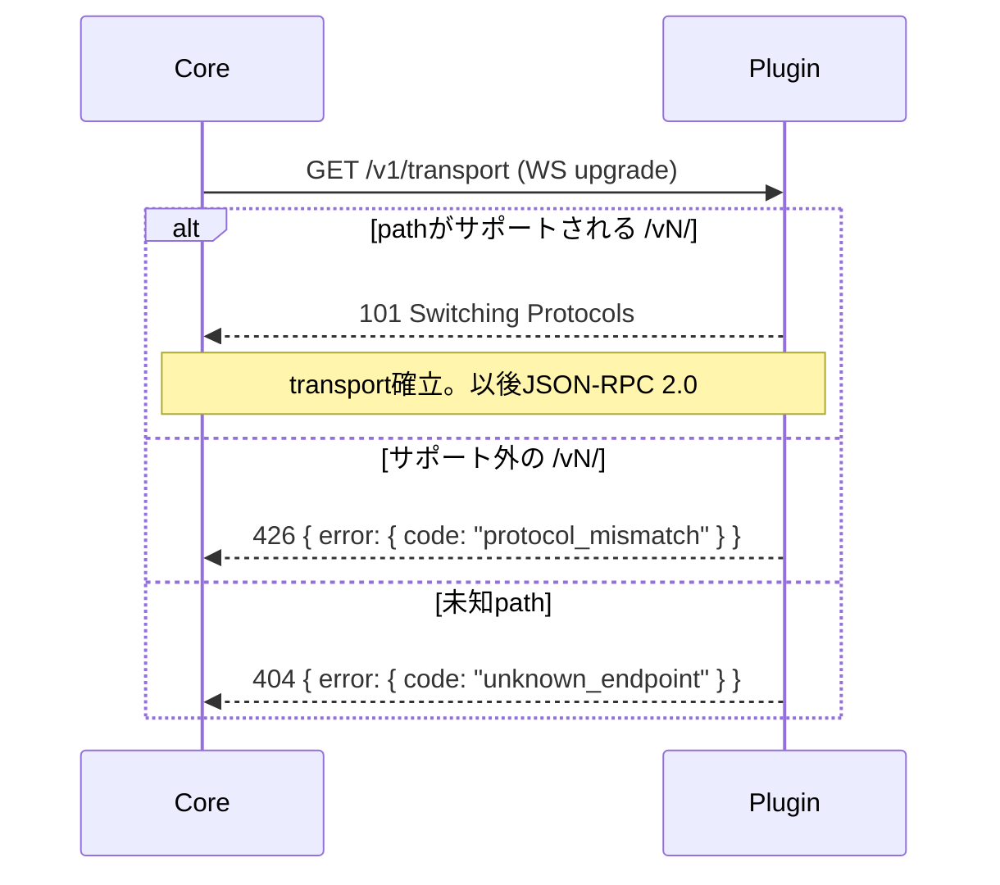
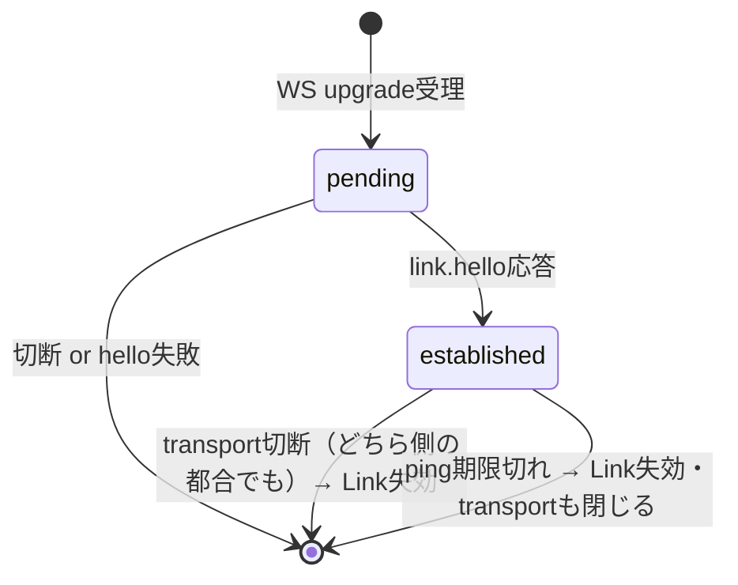

## 当事者と範囲

Core↔Pluginの全通信が流れる唯一のtransport。1つのWS接続がそのまま1つのLinkになる（`docs/contracts/00001`）。本contractはtransportの確立と、その上の全operationのメッセージ形を規定する。

- **Core → Plugin 方向にWS接続する**。Coreは `ws(s)://<plugin-endpoint>/v1/transport` へupgradeを開く。Pluginはupgradeを受け付けるだけで、接続先を知らなくてよい
- transport上のメッセージ形式は **JSON-RPC 2.0**（request/response/notification・id相関・error形状を再利用）
- `tools.call` とその notification の詳細は `docs/contracts/00003` で定義する

## なぜこの形か

- Plugin→Coreの送信は「いつでも・何回でも・継続的に」起こる（Tool実行中の中間出力等）。WS上のJSON-RPCなら順序付きで連続する送信を1接続に載せられる
- 一度張ったtransport上を双方向に流せるため、Core→Pluginの呼び出し・pushもPlugin→Coreの宣言・応答も同じ路に載る
- Plugin側はWS upgradeの受付とJSON-RPC応答だけでよく、client・再接続・接続先設定を実装する必要がない（`docs/decisions/00010`）

## 確立



- transportのpathは `/v1/transport` に固定。Endpoint（`ws(s)://<host>:<port>`）はCoreの設定で決まり、pathは契約で固定する
- upgrade受理前の拒否はHTTP応答（`426`・`404`）で返す。受理後はJSON-RPCメッセージのみが流れる
- **upgrade時点ではLinkはまだ無い**。接続は `link.hello` の応答をもってLinkになる（`docs/contracts/00001`）。helloを受け取らないままの接続は、Plugin側が適当に閉じてよい

## 寿命: transportの切断 = Linkの失効



- **transportとLinkの寿命は一致する**。WSが切れたらそのLink・Tool宣言・紐付くcallはすべて消える。再接続は新しい接続と `link.hello` からやり直す（旧linkIdは再利用しない）
- `link.ping` は半開き（TCPが生きたままアプリが止まった状態）の検出用。pingが失効期限を超えて届かなければ、CoreはLinkを失効させtransportを閉じる
- Plugin側はtransport切断を検知したら、そのLinkの状態を破棄してCoreの再接続を待つだけでよい

## メッセージ形式（JSON-RPC 2.0）

```jsonc
// request（id相関で応答を待つ）
{ "jsonrpc": "2.0", "id": "plugin-1", "method": "tools.set", "params": {…} }
// response
{ "jsonrpc": "2.0", "id": "plugin-1", "result": { "count": 3 } }
// error応答
{ "jsonrpc": "2.0", "id": "plugin-1",
  "error": { "code": -32602, "message": "invalid params" } }
// notification（応答なし）
{ "jsonrpc": "2.0", "method": "link.ping", "params": {} }
```

| code | 意味 |
|---|---|
| `-32700` | Parse error（JSONとして読めない） |
| `-32600` | Invalid Request（JSON-RPCとして形が違う） |
| `-32601` | Method not found |
| `-32602` | Invalid params |
| `-32603` | Internal error |
| `-32000`〜`-32099` | 実装固有のエラー（`tools.call` 等で使用） |

## 全operation一覧

| method | 方向 | 種別 | params→result |
|---|---|---|---|
| `link.hello` | Core→Plugin | request | `{ linkId, core: { id, version? } }` → `{ plugin: { id, version?, name? } }` |
| `tools.set` | Plugin→Core | request | `{ tools: ToolDeclaration[] }` → `{ count }` |
| `link.ping` | Plugin→Core | notification | `{}`（Link維持信号・最終応答時刻を更新） |
| `tools.catalog` | Core→Plugin | notification | `{ tools: [{ linkId, toolPath, kind, description?, tags?, inputSchema?, outputSchema? }] }` |
| `tools.call` | 双方向 | request | `docs/contracts/00003` |
| `tools.call.output` | 双方向 | notification | `docs/contracts/00003` |
| `tools.call.result` | 双方向 | notification | `docs/contracts/00003` |
| `tools.call.close` | 双方向 | notification | `docs/contracts/00003` |
| `plugins.add` | Plugin→Core | request | `{ endpoint }` → `{ endpoint }` |
| `plugins.list` | Plugin→Core | request | `{}` → `{ plugins: [{ endpoint, linkId?, pluginId? }] }` |

- `tools.set`・`link.ping` はtransportがLinkに紐付くため `linkId` を持たない
- `tools.catalog` は「登録中の全Tool」を全置換でpushする。Link確立直後と、`tools.set`・Link失効・動的登録による変化ごとに、Coreは全Linkへ送信する
- `plugins.add` は受理のみでLink確立は非同期。`endpoint` がws(s) URLでない・既知なら `-32602` で拒否する

### ToolDeclaration の形

`tools.set` の `tools[]` と `tools.catalog` の各要素は同じ形を使う（catalog側は `linkId` 付き）。

| field | type | required | 意味 |
|---|---|---|---|
| `toolPath` | string | yes | Link内で一意なTool識別子（構造は未確定） |
| `kind` | string | no | `"sync"` \| `"async"`。省略時 `"sync"`（`docs/contracts/00003`） |
| `description` | string | no | 人間向け説明 |
| `tags` | string[] | no | 検索用ラベル |
| `inputSchema` | object | no | 入力のJSON Schema（任意） |
| `outputSchema` | object | no | 出力のJSON Schema（任意） |
| `linkId` | string | catalogのみyes | そのToolを提供するLinkのID（呼び出しの宛先） |

- `toolPath` の重複は `tools.set` を error `-32602` で拒否し、一覧は変更しない
- `tools.set` は**アトミックな全置換**。部分更新は存在しない

## メッセージ意味論

- 同一transport上のメッセージは**到着順が保証される**
- ただし **transportの到着順とRPCの処理完了順は別物**である。並行処理されるrequestは処理順が入れ替わり得るため、「受信順=完了順」を前提にしてはならない。順序保証が要る処理は呼び出し側がid相関で追跡する
- transportは**両方向**にrequest・notification・responseを流せる。Core→PluginもPlugin→Coreも、requestを発する側・応答する側の両役を同じconn上で持ち得る
- JSON-RPC `id` は「接続ごと・送信方向ごと」の空間で一意ならよい。相手が発行したidと自分が発行するidは別空間（`docs/contracts/00003`「idの一意性」）
- 配送保証: transport上の1メッセージは送達までに失われない（WSの性質上）。切断中のメッセージは再送されない。再送が要る意味論は `tools.call` 等の上位で扱う

## エラー

| 条件 | 応答 |
|---|---|
| サポート外の `/vN/` へのupgrade | `426 protocol_mismatch`（upgrade前HTTP） |
| 未知pathへのupgrade | `404 unknown_endpoint`（upgrade前HTTP） |
| upgrade後のメッセージ形違反 | JSON-RPC error（`-32700` parse error等） |
| 未知のmethod | JSON-RPC error `-32601` |
| `tools.set` の `toolPath` 重複 | JSON-RPC error `-32602` |

## セキュリティと適合性

- `docs/contracts/00001` と同じloopback・認証なし前提。Plugin Endpointがリモートの場合、TLS（`wss://`）・認証は別設計事項（未解決）
- transportはupgradeを受理した者のもの。MVPでは「接続してきた=そのEndpointのpluginである」という信頼モデル。認証は後続contractの設計事項
- WS origin policy・サブプロトコル等の詳細は実装者の自由

## 適合ルール

- Plugin側実装は `/v1/transport` のupgradeを受理し、JSON-RPCメッセージを両方向に処理できること。サポート外versionは426で拒否すること
- Core側実装はPlugin Endpointへの接続・`link.hello` の発行・`tools.set`/`link.ping` の受理・`tools.catalog` の送信・切断時のLink失効を行うこと
- transport切断後、新しい接続で `link.hello` からやり直せること（旧linkIdを再利用しない）

## 未定と未解決の問い

**未定（実装者の自由）:**

- transport再接続の間隔・戦略
- transport上でのJSON-RPCメッセージのフレーム分割・バッチ送信
- helloを受け取らない接続を閉じるまでの待機時間

**未解決の問い（後で決める）:**

- 切断・再接続の扱い（未配送メッセージ・配送保証・再送の上位意味論）
- フロー制御（大量の途中出力時の背圧）
- transportの認証（`wss://` 前提のクレデンシャル）
- transportのWSサブプロトコル名を規定するか
