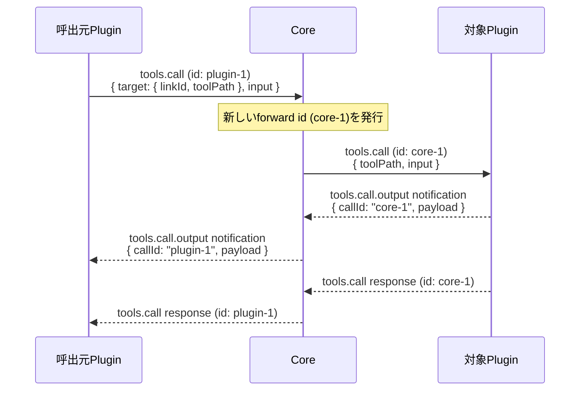
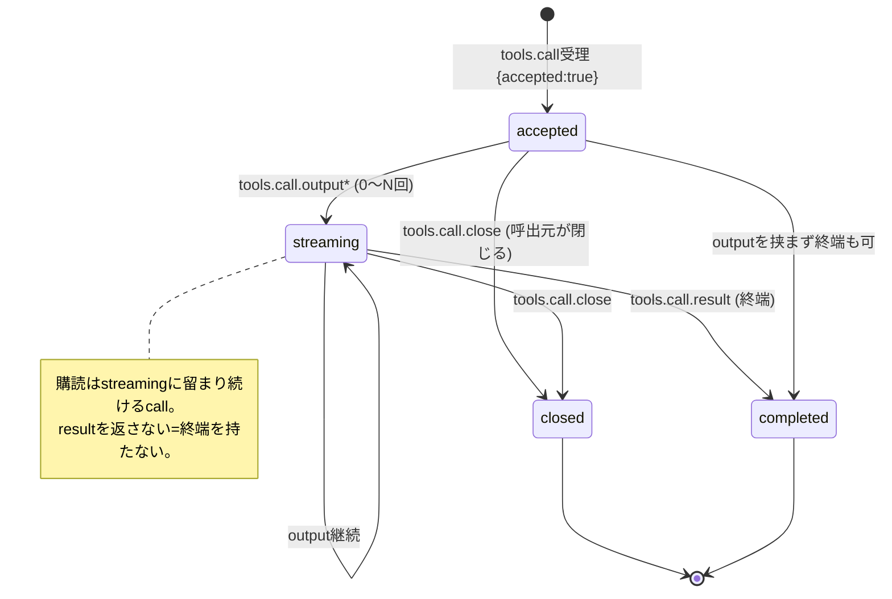

## 当事者と範囲

呼出元Plugin・Core・対象Pluginの3者が実装する呼出契約。全メッセージは `docs/contracts/00002` のtransport（JSON-RPC 2.0）上を流れる。

- 呼出経路は **呼出元Plugin → Core → 対象Plugin** 固定。Coreは宛先を解決・転送し、Tool内部の意味には踏み込まない
- 対象は**呼出元自身のLinkでもよい**（Pluginが自分のToolを経由呼出する用途。例: subagentがAgentのToolを呼ぶ）
- Tool呼出のwireは **sync と async の2形態のみ**。途中出力・通知・購読は別形態ではなく、async形態の意味論として表す

## 形態 — kind 宣言

Tool宣言（`tools.set`）は `kind: "sync" | "async"` を持つ。宣言側が呼出元への期待として付けるラベルであり、wire機構は共通である。

| kind | 意味論 |
|---|---|
| `sync` | 呼出元は完了まで待って次に進む。実行中に途中出力が流れてもよいが、終端が来るまで呼出元は結果を待つ |
| `async` | 呼出元は受理を受け取って先に進み、以後の出力・結果は呼出と並行して届く |

「監視して随時知らせる」購読は `async` の特殊な使い方とする: 終端を持たず開き続けるcall = subscribe。呼出元が閉じるかLink失効で終わる。

## 相関 — callId

JSON-RPC 2.0 の Notification は `id` を持たないため、呼出に続く全メッセージは **`params.callId`** で相関する。

- **callId = 呼出requestのJSON-RPC `id`**。Notificationの `params` に明示して載せる
- 通知は呼出のresponseを待たずに届く。呼出元は、複数の呼出を区別したいときだけcallIdを照合すればよい
- 1つの呼出に紐付く途中出力・終端・エラーはすべて同じcallIdを持つ

### idの一意性

requestの `id` は **接続ごと・送信方向ごとの空間**で一意ならよい。Core中継では次のルールを取る。

- caller側connとtarget側connは別のid空間。Coreはtarget側へ送るrequestに **Core自身が発行するforward id** を使い、caller側のidとは別にする
- target側の `params.callId` はforward idを指す。Coreは呼出に紐付くmessageを中継するとき、各方間で `callId` をその区間のidへ書き換える
- 複数の呼出元が同じ `id` 値を使っても、Coreは `(接続, id)` の組で区別するため衝突しない
- 実装上は接続側ごとのidに発行主体prefixを付けることを推奨する（`plugin-N`・`core-N`）— ログ上の区別がしやすい



## メッセージ

### `tools.call` request（呼出元 → Core）

呼出元が送るrequestのparams。

| field | type | required | 意味 |
|---|---|---|---|
| `target.linkId` | string | yes | 呼出対象のLinkの `linkId`（`tools.list` で得る） |
| `target.toolPath` | string | yes | 呼出対象のtoolPath |
| `input` | any | no | Toolへの入力（toolPathごとのinputSchemaに従う） |

```jsonc
{ "jsonrpc": "2.0", "id": "plugin-1",
  "method": "tools.call",
  "params": { "target": { "linkId": "link-…", "toolPath": "fs/read" },
              "input": { "path": "/tmp/x" } } }
```

### `tools.call` request（Core → 対象）

Coreが対象Pluginへ転送するrequestのparams。**`target` は含めず、toolPathとinputだけを渡す**（対象は自分が呼ばれたことさえ分かればよい）。

```jsonc
{ "jsonrpc": "2.0", "id": "core-1",
  "method": "tools.call",
  "params": { "toolPath": "fs/read", "input": { "path": "/tmp/x" } } }
```

### `tools.call` response — sync呼出の終端

sync toolの戻り値がそのままresponseのresultになる。エラーはJSON-RPC errorとして返る。

```jsonc
// 成功
{ "jsonrpc": "2.0", "id": "plugin-1", "result": { "content": "…" } }
// Tool内部の失敗
{ "jsonrpc": "2.0", "id": "plugin-1",
  "error": { "code": -32000, "message": "file not found" } }
```

### `tools.call` response — async受理

async toolは受理を `{ accepted: true }` のresultで返す。**受理のresponseは終端ではない** — 以後の途中出力・終端はnotificationとして届く。

```jsonc
{ "jsonrpc": "2.0", "id": "plugin-2", "result": { "accepted": true } }
```

受理自体がエラー（toolPath未知・実行拒否等）の場合は通常のerror responseを返し、routeはここで終わる。

### `tools.call.output` notification（対象 → 呼出元、中継）

途中出力。0〜N回届く。

```jsonc
{ "jsonrpc": "2.0",
  "method": "tools.call.output",
  "params": { "callId": "plugin-2", "payload": { "seq": 3, "line": "…" } } }
```

| field | type | required | 意味 |
|---|---|---|---|
| `callId` | JSON-RPC idと同型 | yes | 相関キー（区間ごとに書き換え） |
| `payload` | any | no | toolPathごとの出力形。型分類は後続contract |

### `tools.call.result` notification（対象 → 呼出元、中継）

async呼出の終端。resultまたはerrorの一方を持つ。

```jsonc
// 成功終端
{ "jsonrpc": "2.0",
  "method": "tools.call.result",
  "params": { "callId": "plugin-2", "result": { "exitCode": 0 } } }
// 失敗終端
{ "jsonrpc": "2.0",
  "method": "tools.call.result",
  "params": { "callId": "plugin-2",
              "error": { "code": -32000, "message": "killed" } } }
```

### `tools.call.close` notification（呼出元 → 対象、中継）

開いているcall（購読・長時間実行）を呼出元側から閉じる。

```jsonc
{ "jsonrpc": "2.0", "method": "tools.call.close",
  "params": { "callId": "plugin-2" } }
```

- Coreはcaller側callIdをforward idに書き換えて対象へ届ける
- 対象はcallを停止し、`tools.call.result` で終端を返してよい（result/errorの内容はtool自由）
- すでに終端済み・未知のcallIdへのcloseは無視してよい

## 呼出の流れ

### sync

```
caller → Core → target:  tools.call request { target: { linkId, toolPath }, input }
target → Core → caller:  tools.call.output  notification { callId, payload }*   // 途中出力（あってもよい）
target → Core → caller:  tools.call response                                   // 最終resultまたはerror
```

- response が終端。途中出力のnotificationが先行しても、呼出元はresponseを待って完了とする

### async



- 受理のresponseが先に返り、以後のnotificationは `params.callId` で相関する
- **購読**: `kind: async` で終端resultを返さないcall。呼出元は届くnotificationを受け続ける

## 閉じる

- `tools.call.close` notification `{ callId }`（呼出元 → 対象）— 開いているcallを呼出元側から閉じる
- Link失効で、そのLinkに紐付く全call・全購読は消える
- **呼出元conn切断**: Coreは対象へ `tools.call.close` を転送する — 転送しないと購読・長時間callが対象側で走り続ける（実装上の要求）
- **対象conn切断**: Coreは呼出元へ `tools.call.result` のerror終端を返す（`code: -32000`）

## 途中出力とQueue

届いた途中出力・通知をいつ処理するかは受け手Pluginの内部都合である。Agent PluginがQueueに積む等の振る舞いは `docs/decisions/00002` の領域で、Core契約には含めない。

## エラー

| 条件 | JSON-RPC code | 意味 |
|---|---|---|
| params不正・`linkId` 未知 | `-32602` | invalid params |
| `toolPath` 未知 | `-32601` | no such toolPath |
| method未知 | `-32601` | method not found |
| transport未接続・転送失敗 | `-32000` | plugin transport unavailable / forward failed |
| 対象conn切断でroute消失 | `-32000` | target transport closed |
| Tool内部の失敗 | `-32000` 等 | toolPath側が選ぶ。暗黙の成功扱いはしない |

- **経路の失敗**（未知linkId・未知toolPath・転送不可）はJSON-RPC errorとして呼出元へ返る。Tool内部の失敗と区別する
- **Toolの失敗**は終端result/errorに乗る
- Coreは別候補・別Nodeへの暗黙退避をしない（`docs/designs/00001`）

## 適合ルール

- 対象Plugin実装は `tools.call` の `{ toolPath, input }` paramsを受け、sync toolはresponseで終端を、async toolは受理response→output→result notificationを返せること
- 呼出元Plugin実装は `tools.call` の `{ target, input }` paramsを送り、notification相関・close送信を行えること
- Core実装は宛先解決・forward id発行・callId書き換え・route管理・切断時のclose/error伝播を行うこと

## 未定と未解決の問い

**未定（実装者の自由）:**

- `input`・`payload`・終端resultの中身（toolPathごとのスキーマ。宣言側のinputSchema/outputSchemaが参照）
- 受理response以外の追加受理情報（`accepted` 以外のfieldを将来足すか）
- transport未接続時の待ち合わせ（即座に失敗か待機か — MVPは即座失敗）

**未解決の問い（後で決める）:**

- `tools.call.status` のような呼出状態のpull問合せを別methodとして持つか（通知だけで足りるか）
- `close` と `cancel`（実行中断要求）を区別するか — 現契約では `close` 一本
- 途中出力payloadの形（`tools.call.output` の中身・型分類）
- 購読callの途中出力の型・命名（`tools.call.output` との共用か専用化か）
- timeout・実行時間上限をCoreが持つか（MVPは転送timeout 120秒のみ）
