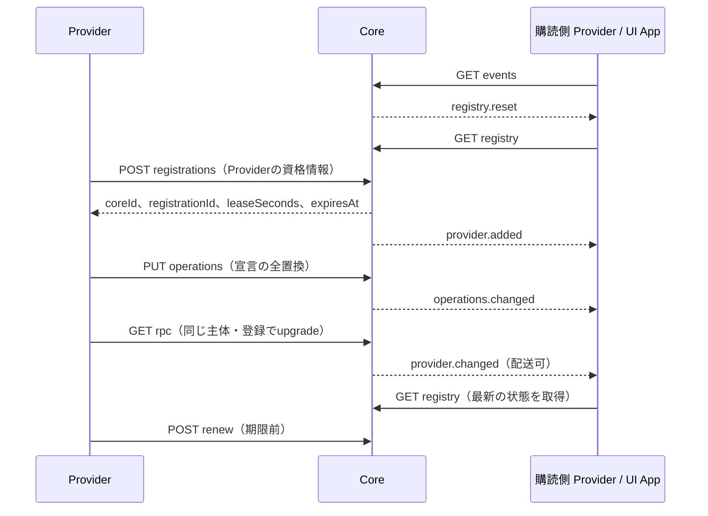
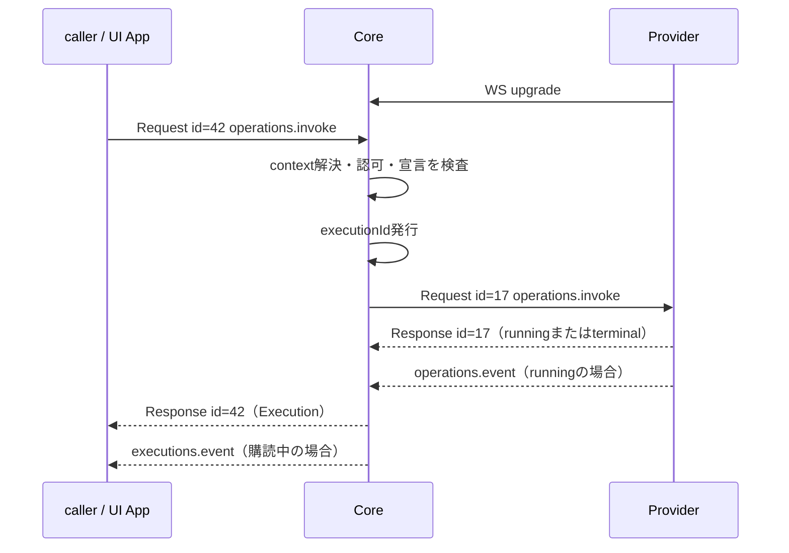

## 当事者・バージョン

**方針:** Coreがサーバー、ProviderとUI Appはクライアント。REST・SSE・WSを同じCoreのHTTP入口で提供し、Providerへの着信はProviderが開始したWSで配送する。operation invocationとPanel専用APIは分ける。

この版は[Decision 00024](../decisions/00024-operation-invocation-context-and-execution.md)に従い、callerが `registrationId + toolPath` を指定する形を廃止する。callerはsemanticなoperation pathとoperation inputを指定し、provider選択と所属解決はCoreが行う。`registrationId` はCore内部の登録・配送管理IDであり、callerが指定する宛先ではない。

**移行:** 開発中の旧 `/v1/` と互換を保たない。旧[接続 00001](00001-core-plugin-transport.md)、[非同期チャネル 00002](00002-async-channel.md)、[Tool呼び出し 00003](00003-tool-call.md)、および旧revisionの `tools.call` / `PUT /tools` はこのcontractの正本ではない。Core・Provider・UI Appを同時に更新する。未対応の版は `426 protocol_mismatch`、廃止された旧パスは `404 unknown_endpoint`。旧方向へのフォールバックはない。

**実装範囲:** 現行実装は旧revisionの `registrationId + toolPath` と `sync` / `async` Tool modelに基づく。この文書は改訂後のcontract案であり、実装は順次移行する。

**このrevisionで変わるもの:** `providerKind` enumの廃止（[Decision 00032](../decisions/00032-routing-and-provider-lifecycle-notes.md)）、`scope` fieldの廃止と所属environment / sessionへの置き換え、Execution status `unknown` の廃止（provider切断は `failed` + error kindで表す）、operation宣言への `presentationSchema` / `embed` の追加（[Design 00010](../designs/00010-panel-embed-widget-view-types.md)）。認証は引き続きloopback上のネイティブクライアントを前提とし、`PLUGUMI_TOKEN` をCoreに設定した場合は全操作に同じBearer資格情報が必要で、所有主体別の権限はない。ブラウザ、運用向け認可、動的なMethod Schema検証、Executionの永続化、credit型Streamingは草案または未実装のまま。

HTTP/1.1でREST・SSEとWS upgradeを利用できることを基準とする。HTTPSではGo `net/http` のネゴシエーションでREST・SSEにHTTP/2を使える。WSがHTTP/2で動くことには依存しない。

## 識別子と認可

| 識別子 | 発行元・スコープ |
|---|---|
| `coreId` | Coreが起動ごとに発行する不透明な文字列。Snapshot、登録、Executionの世代を識別する。Core URLや接続先の認証を代替しない。 |
| `providerId`, `instanceId` | Providerが宣言する実装名と、実行プロセスごとに発行する不透明なID。権限の証明にはならない。`instanceId` の登録時の一意性は認証主体とCoreの世代の内側で扱う。 |
| `registrationId` | Coreが発行する登録ID。Coreの世代内で一意。Lease・WS接続・内部配送を結び付ける。callerはoperation routingの宛先としてこれを指定しない。 |
| operation path | Providerが宣言するsemanticな操作名。`filesystem/list` のようなslash区切りpath。CLI・MCP・HTTP API・AI tool catalogのcanonical名。 |
| `executionId` | Coreがoperation invocationごとに発行するExecution ID。接続やUI sessionから独立し、Execution保持期間内は状態・結果・cancelの参照に使う。 |
| `panelId` | Coreが認可済みUI Appの接続に結び付ける表示インスタンスIDの候補。対象登録・Panel宣言・許可された操作を束縛する。表示終了、UI App接続終了、対象登録の失効で無効。 |
| JSON-RPC `id` | WSと発信方向の内側で一意なrequest-response相関ID。永続的な実行IDではない。Coreは中継先用のIDを別に割り当てる。 |

PoCでは、CLIはCoreごとのスコープ付きBearer資格情報をHTTPSのヘッダーで送る（分離したloopback試験ではHTTP可）。Coreは登録の所有主体を記録し、申告IDだけで別主体を名乗らせない。登録変更・SSE購読・WS upgradeと各RPCを認可する。ProviderのWSと登録更新は同じ認証主体の登録に限る。SSEは認証主体に見えるRegistryだけを配信する。Coreを横断するクライアントはURL・資格情報・`coreId`・登録・RPC状態を別々に保持する。Providerが別Coreへ資格情報を転送しないよう、認証付きリクエストを別Originへ自動リダイレクトしない。

ブラウザでは、信頼されたUI App制御面がCoreと同一Originの場合、`HttpOnly` / `Secure` / `SameSite` のセッションCookieを候補とする。WSの `Origin` を許可リストで検証し、Cookieを使う書き込みにはCSRF対策を設ける。Coreの資格情報をPanelやURLに載せない。Panel操作はBridgeで絞り、Core側でもUI Appの認証、表示インスタンスの所有、対象・メソッドの権限を照合する。非Providerクライアントは登録なしでWSに接続できるが、operation実行には別の権限を要する。認証の期限切れ・失効時には新規操作を拒否し、関連WS/SSEを閉じる。登録用資格情報の失効・管理者の登録取消は更新を拒否するだけでなく配送資格も取り消す。

**未決事項:** 資格情報の発行・更新・組織スコープと監査、ブラウザの独立したOrigin構成、`panelId` の発行操作。外部サービス資格情報をCoreが集約する設計は対象外。

## RESTと登録寿命

単発のREST操作と型は、CoreのHumaが生成する `GET /openapi.json` または `GET /openapi.yaml` を参照する。SSEとWSはRESTクライアント生成の対象に含めない。状態遷移と配送の意味は本書を正本とする。

| 操作 | 意味 |
|---|---|
| `POST /v1/registrations` | `providerId` と `instanceId`、任意で所属（`environment` または `hostSession`）を指定して登録。新規は `201`。同じ実装・インスタンスの存続中の登録には `200` を返す。登録ID・operation宣言・WS接続状態は変えず、受理時点から `leaseSeconds` 分の有効期限を設定する。実装名が異なれば `409 registration_conflict`。 |
| `POST /v1/registrations/{registrationId}/renew` | 失効前に明示更新。登録操作と同じ型で期限を返す。 |
| `DELETE /v1/registrations/{registrationId}` | 登録を取り消す。配送を止め、宣言を公開対象から外す。 |
| `PUT /v1/registrations/{registrationId}/operations` | operation宣言を全置換。空配列で全解除。pathの重複があれば全体を拒否。同じ内容の再送は変更通知を発生させない。 |
| `GET /v1/core` | Coreの識別情報。`coreId` と、Coreに設定されていればCore名 `name` を返す。`coreId` はプロセスごとに変わり、`name` は再起動しても変わらない。他の操作と同じ認証を要する。 |
| `GET /v1/registry` | Snapshot。Coreの世代、`revision`、登録ごとのRPC到達可否とoperation宣言を一貫した時点で返す。 |
| `GET /v1/events` | Registry通知のSSE購読。詳細は次節。 |
| `GET /v1/rpc` | WS upgrade。Providerは `registrationId` をクエリで指定し、資格情報はヘッダーで送る。呼び出し専用接続は登録IDを指定しない。 |

### Plugin manifest

Pluginの場合、`POST /v1/registrations`、`PUT /v1/registrations/{registrationId}/operations`、`PUT /v1/registrations/{registrationId}/ui` などでPlugin runtimeが登録時に送る宣言情報の論理集合をPlugin manifestと呼ぶ。Plugin manifestはファイルではなく、Coreへの登録時に送られるwire上の宣言情報である。wire上は複数のREST操作に分かれるため、単一のmanifest endpointやmanifest fileを前提にしない。

### Providerの所属environment / session

provider sessionは登録時に、自分がどのenvironmentまたはhost sessionに属するかを宣言できる。これはroutingの材料と利用可能期間の導出に使う事実であり、独立した「scope」概念ではない（[Decision 00032](../decisions/00032-routing-and-provider-lifecycle-notes.md)のscope廃止を参照）。

| key | 意味 |
|---|---|
| `environment` | Environment Providerが担当するenvironment ref。例: `env/local`。 |
| `hostSession` | UI Appが登録するoperationが属するhost session ref。例: `host-session/electron-1`。 |

両方を同時に指定してはならない。どちらも持たないproviderはglobal / serviceとして扱う。service accountやbrowser profileとの対応はprovider宣言へ直接書かず、Coreのbinding / credential resolutionで扱う。

`providerKind` enumは廃止する。種別は別々の属性を1つに束ねたものだったため、必要な情報は個別に扱う。installable pluginとの紐付けはplugin管理側が内部で持ち、process管理責任（Core管理 / 外部自生）は接続・起動の経路から分かるため、wire上の種別は要らない。

利用可能期間は独立したmetadataではなく所属から導出する。`host-session/electron-1` に属するoperationはそのUI App sessionが終われば使えず、`env/local` に属するoperationはそのenvironmentが生きている間使える。

### operation宣言

`PUT /v1/registrations/{registrationId}/operations` は次の形を全置換で登録する。

```jsonc
{
  "operations": [
    {
      "path": "filesystem/list",
      "description": "List directory entries",
      "inputSchema": {},
      "acceptSchema": {},
      "streamSchema": {},
      "resultSchema": {},
      "presentationSchema": {},
      "embed": {
        "component": "DiffViewer",
        "catalog": "…"
      }
    }
  ]
}
```

`path` は登録内で一意とする。空のsegment、先頭・末尾の `/`、`/` 以外の空白、`.` / `..` segmentを拒否する。`kind`（`sync` / `async`）、`targetAxes`、`lifetime` は宣言しない。実行時間や途中出力の有無はoperation宣言では固定せず、実際のExecutionが状態を持つ。providerの寿命はprovider sessionとその所属environment / sessionからCoreが導出する。

`inputSchema` / `acceptSchema` / `streamSchema` / `resultSchema` / `presentationSchema` はJSON Schemaとする。`outputSchema` という曖昧な名前は使わない。

operationのoutputは用途ごとに分ける（[Design 00010](../designs/00010-panel-embed-widget-view-types.md)）。`result` はAIやcallerへの判断材料でcompactな構造化データ、`presentation` はembedやsurfaceへ表示するためのデータで、実行中はstreamで随時流し込まれ、component treeではなくdata modelへの入力となる。`presentationSchema` は省略でき、省略時はpresentation出力を持たない。

`embed` はtool紐付けの自動表示の宣言で省略できる。呼び出し時に自動で表示するembed componentを指定する。`embed` を持たないoperationの呼び出しは汎用fallback表示でよい。`embed` の具体的な形式（component参照の解決方法、catalog指定、A2UI templateをinlineで持てるか）は検討中であり、この版では未確定とする。CoreがSchema検証を行う場合は登録時にSchema自体を検査し、invocation時に外部URLへ参照を取りに行かない。現行実装はCoreによる厳密なSchema検証を保証しない。Schemaの検証・型生成は後続の検証対象である。

UIファイルとPanelの宣言は後節で定める。Signalingのワイヤーは拡張候補で、メディア本体はこのAPIのデータではない。

**登録と切断の扱い:** 明示的な登録解除とRPC接続の切断は、[Decision 00012](../decisions/00012-plugin-initiated-connections.md)に従って区別する。

**現行の試作:** Coreは登録をメモリに持ち、登録または更新の受理時点から60秒を有効期限とする。切断時から60秒を数えるわけではない。WSもSSEも登録の期限を自動延長しない。Providerは `leaseSeconds` の半分を目安に更新し、期限はCoreが判定する。providerへ転送した呼び出しの初回応答は120秒で打ち切り、超過時はExecutionを `failed` / `deadline_exceeded` とし、providerへはcancelを送る。

| ケース | 現行の動作 |
|---|---|
| 登録直後 | 宣言は空、WS未接続で配送不可。宣言を更新してもWSがつながるまで呼び出せない。 |
| WSが切断され、登録解除が届かない | 登録と宣言は期限まで残り、配送不可に変わる。期限内なら同じ登録で再接続できる。PoCは登録につきWS一本、既存接続が有効なら二本目を拒否する。 |
| SSEが一時切断 | 登録とWSは変化しない。購読側は再接続してSnapshotを取り直す。 |
| 期限切れ・登録取消 | Coreは登録と宣言を公開対象から外し、関連WSを閉じる。旧登録は再開できず、有効な登録権限でのみ新規登録できる。管理者が再登録も止める場合は、登録取消とは別に登録権限を失効させる。 |
| Core / Provider 再起動 | Core再起動は登録を全消去。Providerは再認証・再登録する。Provider再起動は新しい `instanceId` で登録する。旧登録は配送不可になり、取消か期限切れで消える。 |



新規登録も、存続中の登録に対する再送も、有効期限を設定してから応答する。Providerは接続前に別途更新する必要はない。延長だけではRegistryのRevisionもSSE通知も変わらない。再接続の一時エラーには上限付きバックオフとジッターを使う。認証失効や非互換版は一時エラーとして繰り返さない。

**未決事項:** 登録期限の長さと更新方式は、切断からの復帰にかかる時間と更新の負荷を見て決める。切断中の登録をTUIの通常一覧に出すかどうかも未決定。登録の永続化や透過的なWS再開はPoCの対象外。

### UIファイルとPanelの宣言

Providerは、PanelのUI Bundleを構成するファイルを、登録のたびにCoreへ送る。Coreはファイルを内容のsha256で識別してメモリに保持し、HTTPで配信する。Panelのモジュールの形は[Contract 00005](00005-panel-module.md)で定める。

| 操作 | 意味 |
|---|---|
| `POST /v1/assets/missing` | `{"sha256": [...]}` のうち、Coreが持っていないものを `{"missing": [...]}` で返す。 |
| `PUT /v1/assets/{sha256}` | ファイルの中身をそのまま送る。中身のsha256が一致しなければ `400`。1ファイルの上限は16MiBで、超えると `413`。 |
| `PUT /v1/registrations/{registrationId}/ui` | `{"files": [{"path", "sha256"}], "panels": [{"panelId", "title", "entry", "styles"}]}` で、その登録のUIを全置換する。両方を空配列にすると解除する。Coreが持っていないsha256を参照すると `400 missing_assets`。同じ内容の再送は変更通知を発生させない。 |
| `GET /v1/ui/{registrationId}/{path}` | 登録のUIに含まれるファイルを返す。`Content-Type` は拡張子から決め、`ETag` にsha256を入れる。 |

Providerは、`missing` で不足を確かめ、不足するファイルだけを送ってから、`ui` を登録する。Coreを再起動するとファイルは失われるので、Providerは再登録のたびにこの手順をやり直す。

`files` の `path` は、Bundleのルートからの相対パスとする。Coreは次のパスを拒否する: 空、絶対パス、`path.Clean` した結果と異なるもの（`.`・`..`・連続した `/`・末尾の `/`）、`\` `:` `?` `%` `#` を含むもの、重複。1つのUIのファイル数は1000、合計サイズは64MiBまでとする。`panelId` は小文字の英数字とハイフンで、登録内で一意とする。`entry` と `styles` の各パスは `files` に含まれるパスでなければならない。`styles` は省略でき、重複を含められない。

SnapshotはPanelの宣言を登録ごとの `panels` に含める。登録ごとの `uiSha256` は、`files` をパス順に並べたものと `panels`（宣言順を含む）を正規化したJSONのsha256で、UIのどれか1つのファイルが変わっても変わる。UIを登録していなければ省略する。Coreは、どの登録のUIからも参照されなくなったファイルを削除する。送られたまま60秒以内に参照されなかったファイルも削除する。

### HTTPエラー

本文は `{"error":{"code":"…","message":"…"}}`。機械判定にはstatusと `code` を使う。

| HTTP | code | 条件 |
|---|---|---|
| 400 | `invalid_params` | 不正なJSON、必須項目欠落、宣言・upgrade条件違反 |
| 401 / 403 | `unauthenticated` / `forbidden` | 資格情報の欠落・失効 / 操作権限不足（WSのOrigin不許可を含む） |
| 404 | `unknown_registration` / `unknown_endpoint` | 存在しない・失効した・閲覧不可の登録 / 未知のパス |
| 409 | `registration_conflict` / `rpc_already_connected` | 登録時の実装名不一致 / 同じ登録に既存WSあり |
| 413 / 426 / 429 | `payload_too_large` / `protocol_mismatch` / `rate_limited` | 設定上限超過 / 版不一致 / 頻度超過 |

## SSE: Registry変更通知と復旧

SSEはRegistry通知専用とし、CommandやExecution出力を載せない。`event` は `registry.reset`、`provider.added`、`provider.changed`（配送可否）、`provider.removed`、`operations.changed`、`panels.changed`（UIの登録・置換・解除）。`id` と `data: {"revision":"..."}` の `revision` は同じ不透明な値で、Snapshotの版と同じCore世代に属する。イベントには別の認可範囲の登録情報を含めない。クライアントはRevisionの連番を仮定しない。

```text
id: revision-7f
event: operations.changed
data: {"revision":"revision-7f"}

```

Coreは購読開始時に購読を登録する時点の `registry.reset` を送り、それより後の変更を順に通知する。履歴を持たず、`Last-Event-ID` があっても毎回resetする。購読側はresetを受けてからSnapshotを取得する。取得中に通知が来たら取得後に再読込し、接続が切り替わった場合は旧接続で開始した取得結果を使わない。通知の順序だけでは全変更の履歴を復元できない。バッファ上限超過時は購読を閉じ、同じ手順で再同期する。実行状態やoperation呼び出しは再送しない。

**未決事項:** 履歴と再開カーソルの保持、SSEでのCommand配送、WSで同じRegistry通知を追加する必要性。SSEでCommandを配送すると応答・ACK・再送・重複実行対策を別に作る必要がある。双方向で対話する操作はWS、一方向の大きなデータやBundleはHTTP Streamingを先に比較する。Terminal入力をキーごとのRESTリクエストに固定しない。

## WebSocket: 双方向RPC

JSON-RPC 2.0のRequest、Response、Notification、Errorを使う。PoCはテキストフレームにJSONオブジェクト一つ、Requestの `id` は非空文字列、`params` はオブジェクト。Batchは対象外。Responseには `result` と `error` のどちらか一方だけを入れ、Notificationには `id` を付けない。CoreとProviderは確立済みのWS上でそれぞれRequestを開始できる。

### operation invocation

callerは `operations.invoke` でoperationを呼ぶ。`operation` と `input` は必須、`context` は省略できる。

```json
{"jsonrpc":"2.0","id":"42","method":"operations.invoke","params":{"operation":"filesystem/list","input":{"path":"src"},"context":{"project":"project/plugumi"}}}
```

`input` は宣言したSchemaに従うJSON値。`context` はrouting用の実行文脈で、operation inputではない。初期のcontext keyは `project` と `callerExecution` だけとし、未知のkeyは `-32602` とする。Coreは認証済み接続、caller session、caller executionから追加のcontextを導出する。`callerExecution` を送る場合は、そのExecutionが同じ認証主体・sessionに属することをCoreが確認し、不一致なら `-32001 forbidden` とする。`account` / `host` / `environment` をcallerが直接指定する公開項目は設けない。これらはproject binding、resource ref、接続sessionからCoreが解決する。

Coreは次の順で配送先を解決する。

1. `input` 内のresource refが所属先を持っていれば、その所属先を使う
2. 呼び出し時の `context.project` を使う
3. caller execution / agent sessionのprojectを使う
4. projectのdefault bindingを使う
5. global defaultを使う
6. それでも複数またはゼロなら ambiguous / unavailable errorを返す

複数のresource refが互いに矛盾する所属先を示す場合も、Coreは黙って調停せず `context_ambiguous` とする。Coreは候補を暗黙に選び直さない。同じ所属（environment / session）で同じoperationを複数providerが提供する場合は `context_ambiguous` とする。providerごとに意味や挙動が違うなら、同じoperation名で宣言してはならない。

### operation catalogとAI tool schema

callerは `operations.list` で、指定または接続から導出したcontextで利用できるoperation catalogを取得できる。catalog entryは `path`、`description`、`inputSchema`、`acceptSchema`、`streamSchema`、`resultSchema`、`presentationSchema`、embed宣言を持ち、`registrationId` やprovider固有の宛先を含めない。provider寿命などのmetadataはCoreが導出した値として含めてよい。

```json
{"jsonrpc":"2.0","id":"7","method":"operations.list","params":{"context":{"project":"project/plugumi"}}}
```

AIへ送るtool schemaは、このcatalogのoperation pathと `inputSchema` だけを使う。`context` やprovider選択の項目はAIへ見せない。AI providerやMCP実装がslashをtool名に使えない場合は、adapterだけで `filesystem/list` を `filesystem__list` のような安全な名前へencode/decodeする。Coreのcanonicalなoperation pathは変えない。

### Execution

Coreが受理したすべてのoperation invocationはExecutionとして記録する。fastなoperationは最初からterminal状態のExecutionになる。長時間のoperationはrunningのまま返る。operation宣言に `sync` / `async` 種別はない。

Executionは少なくとも次を持つ。

```jsonc
{
  "id": "execution/123",
  "operation": "filesystem/list",
  "status": "succeeded",
  "createdAt": "…",
  "updatedAt": "…",
  "context": {
    "project": "project/plugumi"
  },
  "result": {}
}
```

| field | 意味 |
|---|---|
| `id` | Coreが発行するExecution ID。 |
| `operation` | 呼ばれたoperation path。 |
| `status` | `queued` / `running` / `succeeded` / `failed` / `cancelled`。terminalは `succeeded` / `failed` / `cancelled`。`unknown` は持たない。providerとの接続が切れて追跡不能になった場合も `failed` とし、実行そのものの失敗とはerror kindで区別する（下記）。 |
| `createdAt` / `updatedAt` | Coreが記録した時刻。 |
| `context` | Coreが解決した実行文脈。少なくともprojectなど、解決に使った公開可能なrefを含める。 |
| `input` | 保存する場合はoperation input。秘密や大きな値をそのまま保存しない方針は別途定める。 |
| `accept` | 受理・開始時に返るoperation固有のデータ。session ref、page ref、購読受理結果など。`executionId` などの共通fieldは含めない。 |
| `progress` | 進行中の任意の構造化情報。 |
| `result` / `error` | terminal状態の結果またはエラー。`result` はAIやcallerへの判断材料。`error` は `{"code":"…","message":"…","data":{},"kind":"…"}` の形で、JSON-RPCの数値コードではなくExecution内では安定した文字列codeを使う。`kind` は少なくとも `executionFailed`（実行そのものの失敗）と `providerDisconnected`（providerとの接続が切れて追跡不能。実行の成否は不明かもしれないがCoreからは追えない）を区別する。 |
| `presentation` | 人間への表示用データ。embedやsurfaceのdata modelへ流し込まれる。実行中はstream eventで随時更新され、terminal時点の値がExecutionに残る。operation宣言の `presentationSchema` に従う。 |
| `resourceRefs` | 実行に関連するresource ref。 |
| `parentExecution` | 親Executionがある場合のref。 |

`operations.invoke` のResponseはExecutionを返す。既にterminalなら `result` / `error` を含めてよい。runningなら含めず、受理・開始時のoperation固有データがある場合は `accept` を含める。operation検証・context解決・認可の失敗など、Executionを作る前の失敗だけをJSON-RPC errorで返す。Executionを作った後のprovider timeoutや追跡不能はJSON-RPC errorではなく、Executionの `failed` 状態と `error` として表す。

```json
{"jsonrpc":"2.0","id":"42","result":{"execution":{"id":"execution/123","operation":"filesystem/list","status":"succeeded","createdAt":"…","updatedAt":"…","context":{"project":"project/plugumi"},"result":{"entries":[]}}}}
```

### Execution参照とcancel

caller向けのRPCは次の通り。

| method | 意味 |
|---|---|
| `operations.list` | contextで利用できるoperation catalogを返す。providerの宛先は含めない。 |
| `operations.invoke` | operationを呼び、Executionを作る。 |
| `executions.get` | `{"executionId":"…"}` でExecutionを取得する。 |
| `executions.list` | 現在のCore世代で参照可能なExecutionを一覧する。filterは `status`、`project`、`parentExecution` を候補とする。 |
| `executions.cancel` | `{"executionId":"…"}` でcancelを要求する。Responseは要求受理時点のExecution。 |
| `executions.subscribe` | `{"executionId":"…"}` またはfilterでExecution eventを購読する。Responseは `{"subscriptionId":"…"}`。 |
| `executions.unsubscribe` | `{"subscriptionId":"…"}` で購読を止める。 |

cancelは協調的で、配送済みの副作用を巻き戻さない。既にterminalなExecutionには作用しない。Coreはcancel要求をproviderへ転送し、終端を待つ。期限までに終端が得られなければ、Core側の状態を `failed` へ進めてよい。この場合のerror kindの扱いは未確定とする。

Execution eventは `executions.event` Notificationで送る。`seq` はExecutionごとに1から単調増加する。

```jsonc
{
  "jsonrpc": "2.0",
  "method": "executions.event",
  "params": {
    "subscriptionId": "subscription/1",
    "executionId": "execution/123",
    "seq": 2,
    "type": "output",
    "payload": {}
  }
}
```

`type` は `status` / `progress` / `output` / `presentation` / `result` / `error` を初期値とする。`payload` の意味はtypeごとに決める。`status` は状態遷移、`progress` と `output` はoperationごとの進行・出力、`presentation` は表示用データのincrementalな更新、`result` / `error` は終端結果を表す。`subscriptionId` はCoreから購読者へ送るeventにだけ含める。購読開始後のeventだけを保証し、過去のevent再送や途中再開は初期contractでは保証しない。現在状態は `executions.get` で取り直す。

### Providerへの配送

Coreはproviderへも `operations.invoke` を送る。paramsには `operation`、`input`、Coreが発行した `executionId` を含める。

```json
{"jsonrpc":"2.0","id":"17","method":"operations.invoke","params":{"operation":"filesystem/list","executionId":"execution/123","input":{"path":"src"}}}
```

ProviderのResponseは初期状態を返す。

```jsonc
{
  "status": "running",
  "progress": {}
}
```

または、既に終了した場合はterminal状態を返す。

```jsonc
{
  "status": "succeeded",
  "result": {
    "entries": []
  }
}
```

Providerがoperationを受理できない場合はJSON-RPC errorを返してよい。このerrorはenvelopeや受理自体の失敗を表す。operation内部の業務的な失敗は、受理後のterminal状態 `failed` とExecution errorとして表す。

runningの場合、Providerは同じ `executionId` を持つ `operations.event` Notificationで進行・出力・終端をCoreへ送る。paramsは `executionId`、`seq`、`type`、`payload` を持ち、`type` と `payload` の意味は購読者向けの `executions.event` と同じである。`seq` はExecutionごとに1から単調増加し、初回Responseはseqに数えない。`subscriptionId` は含めない。Responseでterminal状態を返した場合は、追加のterminal eventを送らなくてよい。Coreは認証済み登録とoperation declarationを照合し、Core側のExecutionへ反映する。Providerがterminal eventを送らず切断・失効した場合、CoreはExecutionを `failed`（`error.kind: providerDisconnected`）へ進める。

cancelはCoreからProviderへ `executions.cancel` Notificationで送る。`executionId` を含める。Providerは可能な範囲で停止し、最後にterminal eventを返す。cancelを無視した場合でも、Coreは無制限には待たない。



### RPCエラー

基本エラーはJSON-RPC標準の `-32700`（不正JSON）、`-32600`（不正Envelope）、`-32601`（未知メソッド）、`-32602`（引数・Schema不正）、`-32603`（内部エラー）。アプリ定義は次の通り。

| code | 意味 |
|---|---|
| `-32001 forbidden` | 権限がない。 |
| `-32002 target_unavailable` | 解決先providerまたはその所属先が現在利用できない。 |
| `-32003 deadline_exceeded` | Coreまたはcaller指定の期限に達した。 |
| `-32004` | （欠番。旧revisionの `outcome_unknown`。追跡不能はExecutionの `failed` + error kindで表し、RPC errorにはしない） |
| `-32005 cancelled` | cancel済み。 |
| `-32006 overloaded` | 有界キューまたはrate limitを超えた。 |
| `-32007 operation_not_found` | operationが見つからない、または権限上見えない。 |
| `-32008 context_ambiguous` | contextだけでは配送先を一意に決められない。error dataに公開可能な候補を含めてよい。 |
| `-32009 execution_not_found` | Executionが見つからない、または権限上見えない。 |

他の認可範囲の対象は存在しないものと区別しない。判定には数値コードを用いる。Coreはoperation実装候補やprovider候補を暗黙に選び直さない。

### 期限・切断・Streaming

- **期限と切断:** Coreは呼び出しに上限時間を適用する。クライアントが指定する場合の候補は `timeoutMs`（正の整数、上限はCore設定）。切断・期限切れ・取消が配送後に起きた場合、副作用が完了していないとは保証できない。追跡不能になったExecutionは `failed` とし、`error.kind: providerDisconnected` で表す。Core・クライアントとも自動再実行しない。同じWSの同じ発信方向でIDを再利用しない。再接続後のIDは別の名前空間。結果照会は `executionId` で行う。永続的な冪等性キーは未決定。
- **Streaming / output:** Executionの `output` eventを使う。大容量データや双方向入力のために別途credit型streamを設ける場合も、eventはExecution IDに紐付ける。初期PoCで検証する方向はProviderからcallerへの出力のみ。双方向の入力、再送・途中再開は未決定。
- **Backpressure:** Coreは区間ごとに有界キューを持ち、下流の受信枠と空きを超えて上流へ送らない。上限・credit違反は無制限に溜めず、エラーで終端するか、終端を配信できなければ接続を閉じる。終端・cancelはデータ用creditを消費しないが、制御側のキューにも上限を設ける。具体的な上限値と大容量のHTTP Streaming契約は未決定。

### surface（A2UI）の扱い

declarative surfaceのpayload仕様はA2UIとする（[Decision 00035](../decisions/00035-a2ui-as-declarative-surface-payload.md)）。A2UI messageをこのcontractのどこに乗せるか（Execution streamに混ぜるか、surface専用のstream / channelを分けるか）は未確定であり、次のrevisionまでに決める。embedの記録性とwidgetの常時更新、実行より長生きするsurfaceの寿命を考慮する必要がある。message logを保持すればreplayで復元できることはspikeで検証済みである。

### Panel呼び出し

Panel呼び出しの候補は `panel.call` とし、`params` は `panelId`（文字列）、`method`（宣言済みPanelメソッド名）、`input`（JSON値）。配送先にはCoreが検証したPanel宣言とメソッドの情報を渡す。Panel専用メソッドをoperation一覧に混ぜず、任意の登録への迂回経路にしない。

## Schema・型生成

RESTはHumaのOpenAPI 3.1とJSON Schemaを基にする。OpenAPI GeneratorでRESTクライアントを生成できる。RPCのEnvelope、Method Schema、生成する型・Stub、RPC Runtime、Core Routerは別の責務。Provider固有のMethodをCoreにコンパイルする必要はない。将来のMethod Schema検証では登録時にSchema自体を検査し、検証中に外部URLから参照先を取得しない。入力・出力のMethod SchemaのPoC例は[echo RPCのJSON Schema](plugin-client-v1.echo.schema.json)。

| RPCスキーマ候補 | 利点 | 採用を見直す条件 |
|---|---|---|
| OpenRPC | Method・引数・結果の記述形式を再発明せずに済む | 双方向、通知、動的Method、型生成のうち必要なものが主要言語のツールで表現できない |
| JSON Schemaを正本に薄い独自生成 | PanelとProviderで型を共有し、既存のJSON Schema生成器を試しやすい | Methodメタデータ、Stub、互換性の独自保守が大きくなる |
| `.proto` / Protobuf（gRPCなし） | 言語横断の静的型と互換性規約を利用できる | REST/OpenAPIと二重定義になり、動的なProviderスキーマを配送・検証するコストが見合わない |

**検証が必要な仮説:** RESTの登録型とRPCのecho型をGo・TypeScript・Rustの既存生成器候補で生成し、同一の正常・異常fixtureを実行時にも検証できる。文字列・必須項目・誤型を含む最小例から始め、追加フィールド、null、整数・union等の扱いも比較する。生成器の採用は未決定で、このSchema例自体は生成・相互接続の成功を証明しない。[Verification 00002](../verification/00002-plugin-client-conformance.md)を参照。
