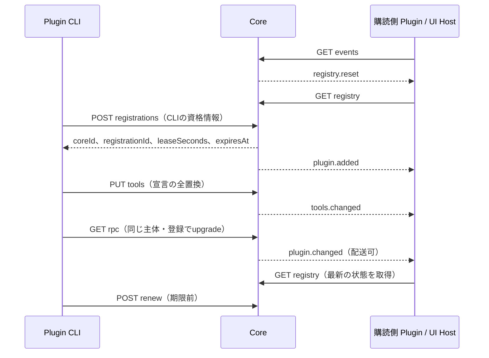
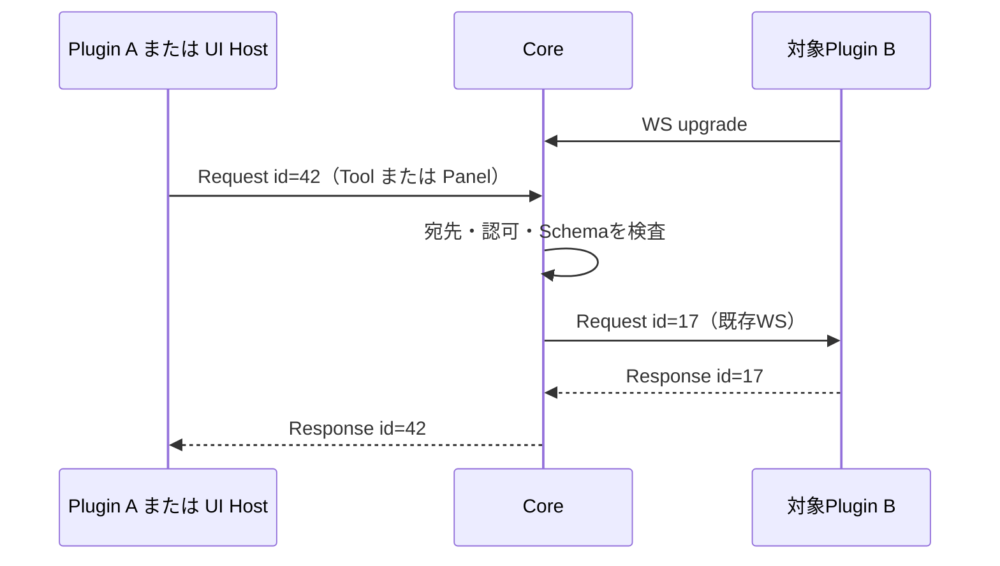

## 当事者・バージョン

**合意済みの方針:** Coreがサーバー、PluginとUI Hostはクライアント。REST・SSE・WSを同じCoreのHTTP入口で提供し、Pluginへの着信はPluginが開始したWSで配送する。ToolとPanel専用APIは分ける。

**移行:** 開発中の `/v1/` をそのまま置き換える。旧[接続 00001](00001-core-plugin-transport.md)、[非同期チャネル 00002](00002-async-channel.md)、[Tool呼び出し 00003](00003-tool-call.md)の旧エンドポイントは提供しない。Core・Plugin・TUIを同時に更新する。未対応の版は `426 protocol_mismatch`、廃止された旧v1パスは `404 unknown_endpoint`。旧方向へのフォールバックはない。

**実装範囲:** 現在はloopback上のネイティブクライアントに限る。下記の登録・Lease・SSE・Tool RPCは利用できる。`PLUGUMI_TOKEN` をCoreに設定した場合は全操作に同じBearer資格情報が必要で、所有主体別の権限はない。ブラウザ、Panel、Bundle、運用向け認可、動的なMethod Schema検証、credit型Streamingは草案のまま。

HTTP/1.1でREST・SSEとWS upgradeを利用できることを基準とする。HTTPSではGo `net/http` のネゴシエーションでREST・SSEにHTTP/2を使える。WSがHTTP/2で動くことには依存しない。

## 識別子と認可

| 識別子 | 発行元・スコープ |
|---|---|
| `coreId` | Coreが起動ごとに発行する不透明な文字列。Snapshotと登録の世代を識別する。Core URLや接続先の認証を代替しない。 |
| `pluginId`, `pluginInstanceId` | Pluginが宣言する実装名と、実行プロセスごとに発行する不透明なID。権限の証明にはならない。`pluginInstanceId` の登録時の一意性は認証主体とCoreの世代の内側で扱う。 |
| `registrationId` | Coreが発行する登録ID。Coreの世代内で一意。Toolの宛先はこれと `toolPath` で決まる。`toolPath` は登録内で一意な文字列で、階層として解釈しない。 |
| `panelId` | Coreが認可済みUI Hostの接続に結び付ける表示インスタンスIDの候補。対象登録・Panel宣言・許可された操作を束縛する。表示終了、Host接続終了、対象登録の失効で無効。 |
| JSON-RPC `id` / `callId` | WSと発信方向の内側で一意な文字列。Coreは中継先用のIDを別に割り当てる。`callId` は通知でその区間のRequest IDを参照するための名前で、永続的な実行IDではない。 |

PoCでは、CLIはCoreごとのスコープ付きBearer資格情報をHTTPSのヘッダーで送る（分離したloopback試験ではHTTP可）。Coreは登録の所有主体を記録し、申告IDだけで別主体を名乗らせない。登録変更・SSE購読・WS upgradeと各RPCを認可する。PluginのWSと登録更新は同じ認証主体の登録に限る。SSEは認証主体に見えるRegistryだけを配信する。Coreを横断するクライアントはURL・資格情報・`coreId`・登録・RPC状態を別々に保持する。Pluginが別Coreへ資格情報を転送しないよう、認証付きリクエストを別Originへ自動リダイレクトしない。

ブラウザでは、信頼されたUI Host制御面がCoreと同一Originの場合、`HttpOnly` / `Secure` / `SameSite` のセッションCookieを候補とする。WSの `Origin` を許可リストで検証し、Cookieを使う書き込みにはCSRF対策を設ける。Coreの資格情報をPanelやURLに載せない。Panel操作はBridgeで絞り、Core側でもHostの認証、表示インスタンスの所有、対象・メソッドの権限を照合する。非Pluginクライアントは登録なしでWSに接続できるが、Tool実行には別の権限を要する。認証の期限切れ・失効時には新規操作を拒否し、関連WS/SSEを閉じる。登録用資格情報の失効・管理者の登録取消は更新を拒否するだけでなく配送資格も取り消す。

**未決事項:** 資格情報の発行・更新・組織スコープと監査、ブラウザの独立したOrigin構成、`panelId` の発行操作。外部サービス資格情報をCoreが集約する設計は対象外。

## RESTと登録寿命

単発のREST操作と型は、CoreのHumaが生成する `GET /openapi.json` または `GET /openapi.yaml` を参照する。SSEとWSはRESTクライアント生成の対象に含めない。状態遷移と配送の意味は本書を正本とする。

| 操作 | 意味 |
|---|---|
| `POST /v1/registrations` | `pluginId` と `pluginInstanceId` で登録。新規は `201`。同じ実装・インスタンスの存続中の登録には `200` を返す。登録ID・Tool宣言・WS接続状態は変えず、受理時点から `leaseSeconds` 分の有効期限を設定する。実装名が異なれば `409 registration_conflict`。 |
| `POST /v1/registrations/{registrationId}/renew` | 失効前に明示更新。登録操作と同じ型で期限を返す。 |
| `DELETE /v1/registrations/{registrationId}` | 登録を取り消す。配送を止め、宣言を公開対象から外す。 |
| `PUT /v1/registrations/{registrationId}/tools` | Tool宣言を全置換。空配列で全解除。パスの重複があれば全体を拒否。同じ内容の再送は変更通知を発生させない。 |
| `GET /v1/core` | Coreの識別情報。`coreId` と、Coreに設定されていればCore名 `name` を返す。`coreId` はプロセスごとに変わり、`name` は再起動しても変わらない。他の操作と同じ認証を要する。 |
| `GET /v1/registry` | Snapshot。Coreの世代、`revision`、登録ごとのRPC到達可否とTool宣言を一貫した時点で返す。 |
| `GET /v1/events` | Registry通知のSSE購読。詳細は次節。 |
| `GET /v1/rpc` | WS upgrade。Pluginは `registrationId` をクエリで指定し、資格情報はヘッダーで送る。呼び出し専用接続は登録IDを指定しない。 |

UIファイルとPanelの宣言は次節で定める。Signalingのワイヤーは拡張候補で、メディア本体はこのAPIのデータではない。

現行のToolには `kind: sync | async` があり、省略時は `sync`。`sync` は応答を終端とする。`async` は `{ "accepted": true }` を先に返し、`tools.call.chunk` と `tools.call.result` を `callId` で相関させる。取消は `tools.call.close`。既存Toolが動くよう応答・通知の形を引き継いだが、旧宛先の `linkId` は受け付けない。

**非同期呼び出しの取消:** Coreは、取消要求と受理応答の両方を受け取った時点から終端通知を待つ。試作では待ち時間を5秒とする。期限までに終端を処理できなければ、Coreは中継を終了し、受理応答の後に `tools.call.result` で `-32004 outcome_unknown` を返す。後から届く通知は中継しない。このエラーは実行が停止したことを示さない。Coreは呼び出しを自動でやり直さない。

**登録と切断の扱い:** 明示的な登録解除とRPC接続の切断は、[Decision 00012](../decisions/00012-plugin-initiated-connections.md)に従って区別する。

**現行の試作:** Coreは登録をメモリに持ち、登録または更新の受理時点から60秒を有効期限とする。切断時から60秒を数えるわけではない。WSもSSEも登録の期限を自動延長しない。Pluginは `leaseSeconds` の半分を目安に更新し、期限はCoreが判定する。targetへ転送した呼び出しの応答は120秒で打ち切り、超過時はcallerへ `-32003 deadline_exceeded` を返し、targetへは `tools.call.close` を送る。

| ケース | 現行の動作 |
|---|---|
| 登録直後 | 宣言は空、WS未接続で配送不可。宣言を更新してもWSがつながるまで呼び出せない。 |
| WSが切断され、登録解除が届かない | 登録と宣言は期限まで残り、配送不可に変わる。期限内なら同じ登録で再接続できる。PoCは登録につきWS一本、既存接続が有効なら二本目を拒否する。 |
| SSEが一時切断 | 登録とWSは変化しない。購読側は再接続してSnapshotを取り直す。 |
| 期限切れ・登録取消 | Coreは登録と宣言を公開対象から外し、関連WSを閉じる。旧登録は再開できず、有効な登録権限でのみ新規登録できる。管理者が再登録も止める場合は、登録取消とは別に登録権限を失効させる。 |
| Core / Plugin 再起動 | Core再起動は登録を全消去。Pluginは再認証・再登録する。Plugin再起動は新しい `pluginInstanceId` で登録する。旧登録は配送不可になり、取消か期限切れで消える。 |



新規登録も、存続中の登録に対する再送も、有効期限を設定してから応答する。Pluginは接続前に別途更新する必要はない。延長だけではRegistryのRevisionもSSE通知も変わらない。再接続の一時エラーには上限付きバックオフとジッターを使う。認証失効や非互換版は一時エラーとして繰り返さない。

**未決事項:** 登録期限の長さと更新方式は、切断からの復帰にかかる時間と更新の負荷を見て決める。切断中の登録をTUIの通常一覧に出すかどうかも未決定。登録の永続化や透過的なWS再開はPoCの対象外。

### UIファイルとPanelの宣言

Pluginは、PanelのUI Bundleを構成するファイルを、登録のたびにCoreへ送る。Coreはファイルを内容のsha256で識別してメモリに保持し、HTTPで配信する。Panelのモジュールの形は[Contract 00005](00005-panel-module.md)で定める。

| 操作 | 意味 |
|---|---|
| `POST /v1/assets/missing` | `{"sha256": [...]}` のうち、Coreが持っていないものを `{"missing": [...]}` で返す。 |
| `PUT /v1/assets/{sha256}` | ファイルの中身をそのまま送る。中身のsha256が一致しなければ `400`。1ファイルの上限は16MiBで、超えると `413`。 |
| `PUT /v1/registrations/{registrationId}/ui` | `{"files": [{"path", "sha256"}], "panels": [{"panelId", "title", "entry", "styles"}]}` で、その登録のUIを全置換する。両方を空配列にすると解除する。Coreが持っていないsha256を参照すると `400 missing_assets`。同じ内容の再送は変更通知を発生させない。 |
| `GET /v1/ui/{registrationId}/{path}` | 登録のUIに含まれるファイルを返す。`Content-Type` は拡張子から決め、`ETag` にsha256を入れる。 |

Pluginは、`missing` で不足を確かめ、不足するファイルだけを送ってから、`ui` を登録する。Coreを再起動するとファイルは失われるので、Pluginは再登録のたびにこの手順をやり直す。

`files` の `path` は、Bundleのルートからの相対パスとする。Coreは次のパスを拒否する: 空、絶対パス、`path.Clean` した結果と異なるもの（`.`・`..`・連続した `/`・末尾の `/`）、`\` `:` `?` `%` `#` を含むもの、重複。1つのUIのファイル数は1000、合計サイズは64MiBまでとする。`panelId` は小文字の英数字とハイフンで、登録内で一意とする。`entry` と `styles` の各パスは `files` に含まれるパスでなければならない。`styles` は省略でき、重複を含められない。

SnapshotはPanelの宣言を登録ごとの `panels` に含める。登録ごとの `uiSha256` は、`files` をパス順に並べたものと `panels`（宣言順を含む）を正規化したJSONのsha256で、UIのどれか1つのファイルが変わっても変わる。UIを登録していなければ省略する。Coreは、どの登録のUIからも参照されなくなったファイルを削除する。送られたまま60秒以内に参照されなかったファイルも削除する。

### HTTPエラー

本文は `{"error":{"code":"…","message":"…"}}`。機械判定にはstatusと `code` を使う。

| HTTP | code | 条件 |
|---|---|---|
| 400 | `invalid_params` | 不正なJSON、必須項目欠落、宣言・upgrade条件違反 |
| 401 / 403 | `unauthenticated` / `forbidden` | 資格情報の欠落・失効 / 操作権限不足（WSのOrigin不許可を含む） |
| 404 | `unknown_registration` / `unknown_endpoint` | 存在しない・失効した・閲覧不可の登録 / 未知のパス |
| 409 | `registration_conflict` / `rpc_already_connected` | 登録時の実装名不一致 / 同じ登録に既存WSあり |
| 413 / 426 / 429 | `payload_too_large` / `protocol_mismatch` / `rate_limited` | 設定上限超過 / 版不一致 / 頻度超過 |

## SSE: 変更通知と復旧

**推奨案:** SSEはPoCではRegistry通知専用とし、CommandやTool実行結果を載せない。`event` は `registry.reset`、`plugin.added`、`plugin.changed`（配送可否）、`plugin.removed`、`tools.changed`、`panels.changed`（UIの登録・置換・解除）。`id` と `data: {"revision":"..."}` の `revision` は同じ不透明な値で、Snapshotの版と同じCore世代に属する。イベントには別の認可範囲の登録情報を含めない。クライアントはRevisionの連番を仮定しない。

```text
id: revision-7f
event: tools.changed
data: {"revision":"revision-7f"}

```

Coreは購読開始時に購読を登録する時点の `registry.reset` を送り、それより後の変更を順に通知する。履歴を持たず、`Last-Event-ID` があっても毎回resetする。購読側はresetを受けてからSnapshotを取得する。取得中に通知が来たら取得後に再読込し、接続が切り替わった場合は旧接続で開始した取得結果を使わない。通知の順序だけでは全変更の履歴を復元できない。バッファ上限超過時は購読を閉じ、同じ手順で再同期する。実行状態やTool呼び出しは再送しない。

**未決事項:** 履歴と再開カーソルの保持、SSEでのCommand配送、WSで同じRegistry通知を追加する必要性。SSEでCommandを配送すると応答・ACK・再送・重複実行対策を別に作る必要がある。双方向で対話する操作はWS、一方向の大きなデータやBundleはHTTP Streamingを先に比較する。Terminal入力をキーごとのRESTリクエストに固定しない。

## WebSocket: 双方向RPC

**推奨案:** JSON-RPC 2.0のRequest、Response、Notification、Errorを使う。PoCはテキストフレームにJSONオブジェクト一つ、Requestの `id` は非空文字列、`params` はオブジェクト。Batchは対象外。Responseには `result` と `error` のどちらか一方だけを入れ、Notificationには `id` を付けない。CoreとPluginは確立済みのWS上でそれぞれRequestを開始できる。

```json
{"jsonrpc":"2.0","id":"42","method":"tools.call","params":{"target":{"registrationId":"registration-b","toolPath":"echo"},"input":{"text":"hello"}}}
```

`input` は宣言したSchemaに従うJSON値。Coreは宛先・権限・宣言を確認して別の `id` で配送する。配送先は `toolPath` と `input` を受け取り、成功時は宣言したSchemaに合う値を `result` に返す。Panel呼び出しの候補は `panel.call` とし、`params` は `panelId`（文字列）、`method`（宣言済みPanelメソッド名）、`input`（JSON値）。配送先にはCoreが検証したPanel宣言とメソッドの情報を渡す。Panel専用メソッドをTool一覧に混ぜず、任意の登録への迂回経路にしない。



基本エラーはJSON-RPC標準の `-32700`（不正JSON）、`-32600`（不正Envelope）、`-32601`（未知メソッド）、`-32602`（引数・Schema不正）、`-32603`（内部エラー）。アプリ定義の候補は `-32001 forbidden`、`-32002 target_unavailable`、`-32003 deadline_exceeded`、`-32004 outcome_unknown`、`-32005 cancelled`、`-32006 overloaded`、`-32007 target_not_found`。他の認可範囲の対象は `target_not_found` と区別しない。判定には数値コードを用いる。CoreはTool候補を暗黙に選び直さない。

### 期限・キャンセル・Streaming

- **期限と切断:** Coreは呼び出しに上限時間を適用する。クライアントが指定する場合の候補は `timeoutMs`（正の整数、上限はCore設定）。切断・期限切れ・取消が配送後に起きた場合、副作用が完了していないとは保証できない。結果を受け取れなければ結果不明として扱う（相手が残っている場合は `outcome_unknown` または期限・取消のエラー）。Core・クライアントとも自動再実行しない。同じWSの同じ発信方向でIDを再利用しない。再接続後のIDは別の名前空間。結果照会・永続的な冪等性キーは未決定。
- **キャンセル:** `rpc.cancel` Notificationに `{"callId":"42"}` を渡す案。Coreは対象区間のIDに変換して転送する。取消は協調的で、配送済みの副作用を巻き戻さない。既に終了した呼び出しには作用しない。Coreは一つの終端のみを呼び出し元へ返す。
- **Streaming拡張候補:** `rpc.stream.open` Requestに、呼び出し種別と通常RPCの引数、初期 `credit`（正の整数、許可チャンク数）を渡す。受理Responseの後に `rpc.stream.chunk`（`callId`, `seq`, `data`）、受信側から `rpc.stream.credit`（`callId`, `credit`）、最後に `rpc.stream.end`（`callId` と `result` または `error`）を送る。`seq` は1から始まり呼び出し・ストリーム方向ごとに単調増加し、順序の判定にはWS到着順と `seq` を用いる。初期PoCで検証する方向は対象から呼び出し元への出力のみ。双方向の入力、再送・途中再開は未決定。
- **Backpressure:** Coreは両区間を別に数え、下流の受信枠と有界キューの空きを超えて上流にcreditを与えない。上限・credit違反は無制限に溜めず、エラーで終端するか、終端を配信できなければ接続を閉じる。終端・キャンセルはデータ用creditを消費しないが、制御側のキューにも上限を設ける。具体的な上限値と大容量のHTTP Streaming契約は未決定。

## Schema・型生成

RESTはHumaのOpenAPI 3.1とJSON Schemaを基にする。OpenAPI GeneratorでRESTクライアントを生成できる。RPCのEnvelope、Method Schema、生成する型・Stub、RPC Runtime、Core Routerは別の責務。Plugin固有のMethodをCoreにコンパイルする必要はない。将来のMethod Schema検証では登録時にSchema自体を検査し、検証中に外部URLから参照先を取得しない。入力・出力のMethod SchemaのPoC例は[echo RPCのJSON Schema](plugin-client-v1.echo.schema.json)。

| RPCスキーマ候補 | 利点 | 採用を見直す条件 |
|---|---|---|
| OpenRPC | Method・引数・結果の記述形式を再発明せずに済む | 双方向、通知、動的Method、型生成のうち必要なものが主要言語のツールで表現できない |
| JSON Schemaを正本に薄い独自生成 | PanelとPluginで型を共有し、既存のJSON Schema生成器を試しやすい | Methodメタデータ、Stub、互換性の独自保守が大きくなる |
| `.proto` / Protobuf（gRPCなし） | 言語横断の静的型と互換性規約を利用できる | REST/OpenAPIと二重定義になり、動的なPluginスキーマを配送・検証するコストが見合わない |

**検証が必要な仮説:** RESTの登録型とRPCのecho型をGo・TypeScript・Rustの既存生成器候補で生成し、同一の正常・異常fixtureを実行時にも検証できる。文字列・必須項目・誤型を含む最小例から始め、追加フィールド、null、整数・union等の扱いも比較する。生成器の採用は未決定で、このSchema例自体は生成・相互接続の成功を証明しない。[Verification 00002](../verification/00002-plugin-client-conformance.md)を参照。
