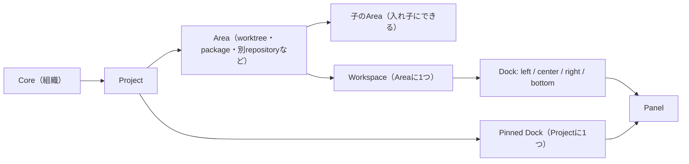
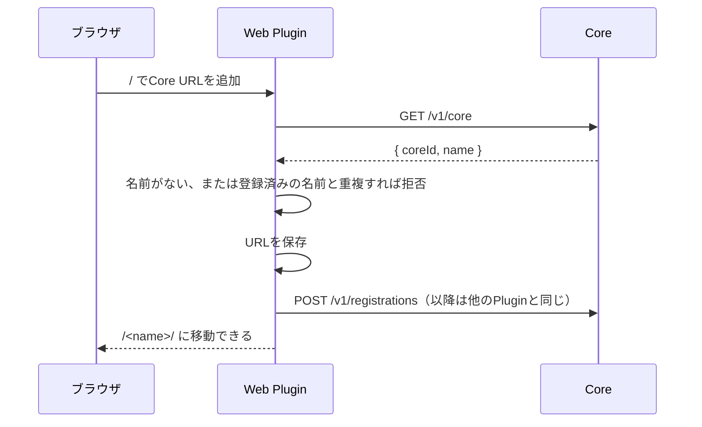

## 対応するrequirement

[Requirement 00003](../requirements/00003-plugin-ecosystem-support.md)は、同じPluginプロセスが複数のCoreへ独立に接続できることを求めている。[Requirement 00004](../requirements/00004-common-protocol-contracts.md)は、人間がPluginの機能や結果を画面から利用できることを求めている。本書は、[Decision 00013](../decisions/00013-web-plugin-gateway.md)で決めたWeb Pluginについて、複数のCoreを1つのブラウザ画面で切り替える方法と、画面の階層を定める。

## 画面の階層

- Areaは入れ子にでき、フォルダのようなツリーになる。親のAreaも子のAreaも、それぞれWorkspaceを1つずつ持つ。
- WorkspaceはAreaと1対1に対応する。Workspaceは、left・center・right・bottomの4つのDockを持ち、各DockにPanelのタブを並べる。
- PinnedのDockはProjectに属し、Areaを切り替えても閉じない。Areaの形が固まったら、Pinnedの扱いは見直す可能性がある。
- Areaが何を持つか（参照するリソースや種類の表し方）は、入れ子の構造のほかは未決定。

## 保存

Project・Area・Workspace・Pinnedの状態は、Web Pluginのサーバーが `~/.plugumi/web/<Core名>.json` に保存する。Coreはこれらの階層を扱わない。

- Core名をキーにする。`coreId` はCoreの再起動で変わるので、Core名のないCoreではProjectを作れない。
- PanelはPanel InstanceのIDと、Pluginの識別子（`pluginId`）と `panelId` で保存する。登録の識別子（`registrationId`）はPluginの再起動で変わるので保存しない。表示するときに、同じPluginの同じPanelを提供している登録を探す。
- 同じWorkspaceを複数のタブで同時に編集した場合は、後から保存した内容が残る。
- `~/.plugumi/` には旧リポジトリのファイルが残っている場合がある。Web Pluginは `~/.plugumi/web/` の下だけを使い、それ以外には触れない。

## URL

| パス | 画面 |
|---|---|
| `/` | Core一覧。Coreの追加と削除もここで行う |
| `/<core>/` | Coreの中のProject一覧 |
| `/<core>/<project>/` | Projectの画面。Areaのツリーと、PinnedのDockを表示する |
| `/<core>/<project>/<area>/<子のarea>/...` | そのAreaのWorkspace |

`<core>` にはCore名を使う。Core名がないCoreは `coreId` で表すが、`coreId` はCoreの再起動で変わるため、ブックマークには使えない。

ProjectとAreaは、名前をそのままURLの識別子にする。名前の形式はCore名と同じ（小文字の英数字とハイフン、1〜63文字）で、同じ親の中では重複できない。Projectの名前はCoreの中で、Areaの名前は同じ親のAreaの中で一意とする。

Web Plugin自身も、APIの `/api/`、ビルド済みファイルの `/assets/`、PanelのUIファイルを中継する `/ui/` をパスの先頭に使う。そのため、Web Pluginは `api`・`assets`・`ui` をCore名として予約し、URLには使わない。これらはWeb Plugin側の都合なので、Coreの設定では禁止しない。Core名が予約名と同じCoreは、画面から追加できない。`--core` で指定されている場合は一覧に表示するが、リンクは作らない。

## Coreの一覧と名前の解決

Web Pluginは2種類の経路で接続先を受け取る。

| 経路 | 保存 | 画面からの削除 |
|---|---|---|
| 起動コマンドの `--core`、または `PLUGUMI_CORE_URL` | しない（起動のたびに指定する） | できない |
| `/` の画面から追加 | Web Pluginの設定ファイルに保存する | できる |

同じoriginのURLは1つにまとめる。接続先が1つもない状態でも、Web Pluginは起動する。

- 画面から追加するときは、Core名が必須である。名前がなければ、Web Pluginは「`core.name` を設定してください」と返して追加を断る。
- Web Pluginは、Coreに登録するたびに `GET /v1/core` を呼び、`coreId` とCore名を取り直す。Core名が変わった場合、Web Pluginは新しい名前でURLを作り、古いURLは使えなくなる。
- 保存されるのはURLなので、Coreのポートは固定する必要がある。Coreの既定のポートは `0` で、起動のたびに変わる。

## Core名の一意性

- Coreは起動時に、同じOSユーザーで動いている他のCoreを調べ、同じCore名のCoreがあれば起動しない。
- Web Pluginは、画面から追加するCoreの名前が、接続中の他のCoreと重なれば追加を断る。
- 別のマシンのCoreとの名前の重複は、まだ扱わない。現行のCoreはloopbackでだけ待ち受ける。

## インターフェース

Core名を返すAPIは[接続契約 00004](../contracts/00004-plugin-client-protocol.md)の `GET /v1/core` を正本とする。ブラウザとWeb Pluginの間のAPIは、Web Plugin内部のものとして扱い、契約にはしない。

## 未解決の問い

- Areaが入れ子の構造のほかに持つ内容
- Areaの形が固まったあとのPinnedの扱い
- 名前に日本語などを使えるようにするか（表示名とURLの識別子を分けるか）
- 同時編集を後勝ちより丁寧に扱う必要があるか
- 同じマシンで動いているCoreを、URLを入力せずに一覧から選べるようにするか
- 別のマシンのCoreを扱うときの、Core名の重複と認証
