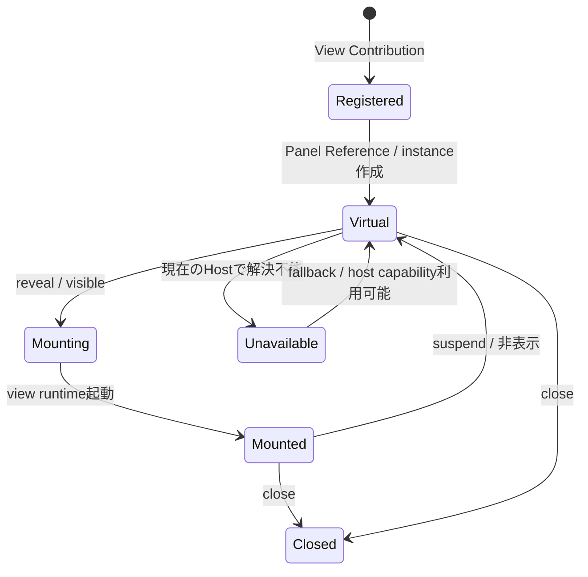

## 対応するrequirement

[Requirement 00004](../requirements/00004-common-protocol-contracts.md)は、人間がPluginの機能や結果を利用するためのPlugin Views Protocolを求めている。このdesignは、Hostごとに表示能力が違う環境で、Panel参照を安全に解決する方法を定める検討案である。

## 背景

Electron native browserはWeb Hostでnative表示できない。しかし、Web UIやAIからCore経由で操作することはできる。このとき、Panel参照をそのままWebへ同期すると、Web側に対応するView実装がなく、表示が壊れる可能性がある。

また、Workbench復元時に多数のPanelを一度にmountすると起動が重い。開かれるまでview runtimeを起動しない仕組みが必要である。

Panel Instance、Mount寿命、Layout Snapshot、writer claimなどの基本設計は、modstrataの `docs/design/ui/panel.md`、`docs/design/workbench/ui-state.md`、`docs/design/workbench/multi-view.md` を参照し、再発明しない。特に、Panelのclose / move /表示切替と業務処理の停止を結び付けない前提を引き継ぐ。

## モデル

このdesignでは次の概念を分ける。

| 概念 | 意味 |
|---|---|
| View Contribution | 開けるViewの種類と、対応するresource / intent / 必要なHost capabilityの登録 |
| Panel Reference | 共有・保存できるPanelへの参照。resource、intent、preferred view、params、寿命などを持つ |
| virtual panel instance | Panel instanceとして存在するが、view runtimeをまだmountしていない状態 |
| mounted panel instance | 実際にview runtimeが動き、DOMへ描画している状態 |
| unavailable panel | 現在のHostでは表示できないが、参照として存在する状態 |
| View Implementation Registry | 現在のHostで利用できるView実装のregistry |

Panel Referenceは実行中のView実体ではない。各HostがPanel Referenceを解釈し、表示方法を決める。

## Panel Referenceの内容

Panel Referenceは少なくとも次を持ち得る。

```jsonc
{
  "id": "panel_123",
  "resource": "browser/page/abc",
  "intent": "control",
  "preferredView": "browser/native-webcontents",
  "requiredHostCapabilities": ["browser/native-webcontents"],
  "lifetime": "host-session",
  "originHost": "host/electron-1",
  "params": {},
  "title": "Browser"
}
```

`preferredView` はヒントであり、Panelの意味そのものではない。同じresource + intentを処理できる別Viewがあれば、Hostはfallbackを選んでよい。`requiredHostCapabilities` をPanel Referenceへ置くか、View Contribution側の要件に留めるかは未決定である。fallbackを許す場合は、必須capabilityとpreferred capabilityを分ける必要がある。

## 状態遷移



suspendしてvirtualへ戻すかは未決定である。少なくとも、Workbench復元時にはinstanceを復元しつつ、表示されるまでmountしない。

## Hostごとの解決

HostはPanel Referenceを受け取ると、次の順で解決する。

1. resource + intentから利用可能なView候補を探す。
2. preferredViewが利用可能なら優先する。
3. requiredHostCapabilitiesを現在のHost capabilityと照合する。
4. Pluginのview entryなら、必要なPluginをactivateしてentryをloadする。
5. Host bundledなViewなら、必要になった時点でlazy importする。
6. fallback Viewがあるなら利用者へ提示するか、設定に従って開く。
7. どれも使えないならunavailable panelを表示する。

## virtual panelの不変条件

virtual panelはinertである。

- DOMを持たない。
- view runtimeを持たない。
- event listener、timer、background処理を持たない。
- 実行中処理のownerではない。

virtual panelに保存してよいのは、ID、view type、resource ref、intent、params、title、layout位置、restore stateなどのserializableな情報である。closure、DOM node、live objectは保存しない。

裏で動く処理はvirtual panelへ置かない。長時間動く処理はPluginのruntime entryまたはProviderへ置く。shell全体へ効くcustomizationはPluginのentryへ置かず、公式shellの `shared/` 実装またはforkで扱う。

## badge / activityの扱い

Agent実行中のbadgeや進行状態は、Panel内部のJSが所有しない。Executionやruntime eventをWorkbench shellが購読し、Panel metadataへ反映する。view runtimeがmountされているときは、その状態を詳しく表示する。

この分離により、Panelがvirtualでも実行状態を失わない。

## unavailable panelの状態表示

Web Hostで表示できない場合は、クラッシュや暗黙の削除をしない。理由を区別して表示する。

| 状態 | 意味 |
|---|---|
| `unsupported` | このHostには必要なcapabilityがない |
| `missing-view` | Viewを提供するPluginが入っていない |
| `runtime-unavailable` | 元のHostまたはProviderが動いていない |
| `fallback-available` | 別Viewなら表示できる |

例えばElectron native browserなら、Webでは次のようなcontrol-only panelを出せる。

```text
Electron上のNative Browser
状態: 実行中
URL: ...
[操作] [停止] [Electronで表示]
```

画面が映らなくても、operationが生きているならPanel参照自体は意味を持つ。

## browserへの適用

browserでは表示レベルを分ける。

| レベル | Webでの表示 |
|---|---|
| native interactive | できない |
| live stream / screenshot | ProviderとHostが対応していればできる |
| status / control only | できる |
| 完全unavailable | Provider offlineなど |

durable browser provider上のpageなら、Webではstream viewerやscreenshot viewerへfallbackできる可能性がある。Electron native browserがhost-session runtimeそのものなら、Electronが生きている間だけ有効であり、Webではcontrol-onlyまたはunavailableになる。

## 未解決の問い

- Workbench状態はHost間で共有する方向だが、layoutの配置まで共有するか、配置だけHost sessionごとに持つか。
- virtual化したPanelのrestore stateを誰が保存し、どこまで復元を保証するか。
- Panel Referenceのfallbackを自動で開くか、利用者へ確認するか。
- Electron native browserのstream / screenshotをProvider capabilityとして公開するか。
- unavailable panelをlayoutへ残すか、別一覧へ畳むか。
